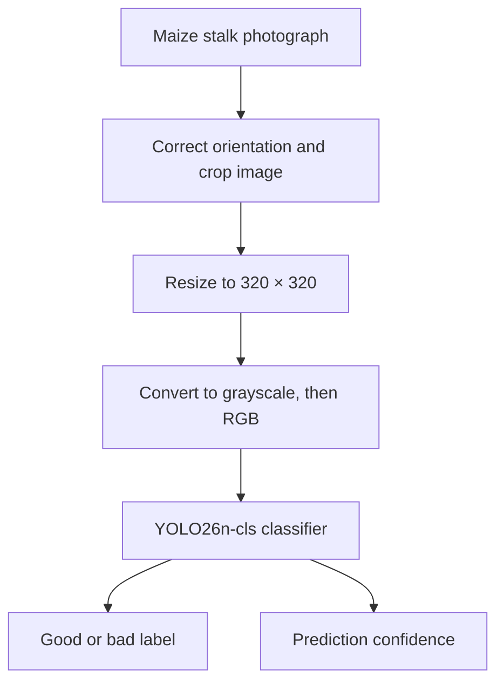
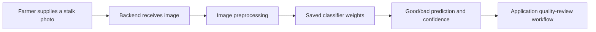

# AI and Machine Learning

## 1. Overview

Afyra's image-classification work focuses on assessing the visible condition of **dry maize stalks**. The classifier accepts a photograph and predicts one of two labels: **good** or **bad**. This is a visual quality check, not a laboratory test or a guarantee of feed safety.

The implementation documented here comes from the `stalk_classifier_v4.ipynb` training notebook. The model is a fine-tuned **YOLO26n-cls** image classifier, built with Ultralytics. It starts from pretrained weights rather than learning image features from scratch.

| Class  | Meaning in the training notebook                               |
| ------ | -------------------------------------------------------------- |
| `good` | Dry, healthy-looking brown maize stalk without visible disease |
| `bad`  | Stalk with visible rot, lesions, breakage or lodging           |

The model uses **two classes only**. These classification labels should not be confused with a three-level grading system or a separate market-price calculation.

## 2. Model Architecture

YOLO26n-cls is a lightweight image-classification model. Unlike an object detector, which draws boxes around objects, the classifier produces a label for the image as a whole and a confidence score.

The saved training output identifies the YOLO26n-cls model with **47 layers**, approximately **1.53 million parameters**, and **3.2 GFLOPs** in its fused summary.



The 320 × 320 size describes the notebook's dataset and inference preprocessing. During model training, Ultralytics uses an `imgsz` setting of **224**.

## 3. Image Collection and Labelling

The notebook builds its dataset using two sources:

1. **Web photographs** gathered through DuckDuckGo image searches in October 2026. Searches cover dry stalks, stalk rot, fallen stalks and related conditions.
2. **Kaggle Maize Stalk Diseases Dataset**, using images from the `giberella` folder for the bad class. The notebook limits these images to at most one-third of the bad class to reduce dependence on one source.

The initial download output reports **123 successful good-image downloads** and **96 successful bad-image downloads**, while the raw folders subsequently contained **115 good** and **74 bad** images. These are collection-stage counts, not the final training dataset.

Labels are based on visible appearance. The notebook describes the labels as assigned by the project author; they are not presented as laboratory-confirmed diagnoses.

### Image cleaning

The preparation pipeline includes:

- A first-pass image screen using **CLIP** (`openai/clip-vit-base-patch32`) to separate likely irrelevant search results into `rejected/` folders.
- Manual review of kept and rejected images, with helpers to delete or restore files.
- Removal of exact and near-duplicate photographs using image hashes.
- Cropping the bottom 10% of images to reduce stock-photo watermark bars.
- Standardizing images to **320 × 320 pixels**.
- Converting images to **grayscale**, reducing the chance that the model simply learns color differences.

The CLIP pass moved **26 of 115 good images** and **14 of 74 bad images** into rejected folders. The Kaggle import output shows **100 giberella images** before the final dataset-building restrictions were applied.

## 4. Dataset and Splitting

The final dataset contains **165 images**: **87 good** and **78 bad**.

| Dataset split |   Good |    Bad |   Total |
| ------------- | -----: | -----: | ------: |
| Training      |     52 |     51 |     103 |
| Validation    |     13 |     13 |      26 |
| Test          |     22 |     14 |      36 |
| **Total**     | **87** | **78** | **165** |

Training images teach the model, validation images help assess training, and test images are reserved for evaluation on unseen examples. The notebook keeps Kaggle images out of the test set, so the test split uses web photographs.

A separate set of **10 field photographs** is held outside the train, validation and test splits for an additional check.

## 5. Model Training

The notebook trains a pretrained Ultralytics classification checkpoint on the prepared dataset.

| Setting                           | Value used                                 |
| --------------------------------- | ------------------------------------------ |
| Model                             | `yolo26n-cls.pt`                           |
| Training epochs                   | 30                                         |
| Training image size               | 224                                        |
| Batch size                        | 32                                         |
| Random seed                       | 0                                          |
| Dataset directory                 | `dataset`                                  |
| Project/name                      | `runs` / `stalk`                           |
| Training hardware shown in output | NVIDIA Tesla T4 GPU                        |
| Best checkpoint                   | `runs/classify/runs/stalk/weights/best.pt` |

The code includes a fallback to `yolo11n-cls.pt` if YOLO26n-cls cannot be loaded. The saved run output specifically identifies **YOLO26n-cls** as the model used.

```python
from ultralytics import YOLO

model = YOLO("yolo26n-cls.pt")
model.train(
    data="dataset",
    epochs=30,
    imgsz=224,
    batch=32,
    seed=0,
    project="runs",
    name="stalk",
    exist_ok=True,
)
```

The notebook reports a validation top-1 accuracy of approximately **0.962** after training.

## 6. Model Evaluation

Evaluation uses accuracy, precision, recall, F1-score and confusion matrices. **Recall for the bad class matters especially:** a bad stalk incorrectly predicted as good could be accepted when it should receive further review.

### Validation and test results

| Metric            | Validation (26 images) | Test (36 images) |
| ----------------- | ---------------------: | ---------------: |
| Accuracy          |                    96% |              92% |
| Good-class recall |                   100% |             100% |
| Bad-class recall  |                    92% |              79% |
| Good-class F1     |                   0.96 |             0.94 |
| Bad-class F1      |                   0.96 |             0.88 |

The test set contains **33 correct predictions out of 36**. All 22 good images were classified correctly; three of 14 bad images were incorrectly classified as good.

**Test confusion matrix** (rows = actual label; columns = predicted label):

| Actual / predicted | Bad | Good |
| ------------------ | --: | ---: |
| Bad                |  11 |    3 |
| Good               |   0 |   22 |

### Field-photo holdout evaluation

The notebook also evaluates **10 independently held-out field photos**: five good and five bad.

| Metric            | Field-photo result |
| ----------------- | -----------------: |
| Overall accuracy  |         70% (7/10) |
| Good-class recall |         100% (5/5) |
| Bad-class recall  |          40% (2/5) |

**Field-photo confusion matrix:**

| Actual / predicted | Bad | Good |
| ------------------ | --: | ---: |
| Bad                |   2 |    3 |
| Good               |   0 |    5 |

The field test is substantially harder for the classifier than the web-image test. Three bad stalks were labelled good, some with high confidence. This is important when deciding whether the prediction can be trusted without a human review.

### Background-bias check

The notebook tests whether image backgrounds provide clues about the label. A separate logistic regression classifier is trained using only the left and right edges of the training images.

- Edge-only accuracy: **0.680**
- Majority-class baseline: **0.505**

Because the edge-only score is higher than the baseline, the images contain some background or scene information related to the class. This is a reason to test with more varied real-world photographs.

## 7. Inference and Model Artifacts

The notebook saves two deployment-oriented files:

| File               | Purpose                                         |
| ------------------ | ----------------------------------------------- |
| `stalk_model.pt`   | Copy of the best trained classification weights |
| `predict_stalk.py` | Preprocessing and prediction helper             |

The helper accepts an image path or PIL image, corrects orientation, crops/resizes to 320 × 320, converts to grayscale and returns a label with confidence.

```python
{
    "label": "bad",
    "confidence": 1.0
}
```

This example is the notebook's saved test-call output. It is **not** a documented live API response schema.

The notebook also copies the dataset, holdout images, raw and rejected folders, and prediction artifacts to a Google Drive folder named `stalk_project`.

## 8. Integration Considerations

The trained model can be called from a backend service that receives a maize stalk image. The integration must use the **same image preprocessing** as the notebook; otherwise, predictions may differ from the evaluated model.



This diagram describes the intended connection between the saved model and the application. The notebook verifies the local prediction helper, but it does not itself demonstrate a deployed Afyra endpoint or an end-to-end mobile-to-backend request.

A prediction should be treated as **decision support**, particularly when the model labels a stalk good. Quality classification and price estimation are separate responsibilities.


>**Note: AI-Assisted Pre-Screening**
>
> Afyra's AI model helps manufacturers assess the potential quality of crop residues before placing sourcing orders. It analyzes uploaded images and provides an initial prediction using the **Good** and **Bad** quality categories.
>
> These predictions are intended to support early screening, not to provide a definitive judgment of residue quality. Actual quality may depend on factors that cannot be reliably determined from an image alone.
>
> By providing this initial assessment, Afyra helps manufacturers identify potentially suitable residues, make more informed sourcing decisions, and reduce the need to physically inspect every available listing before deciding which ones to pursue.
>
> **The final decision on residue quality and whether to proceed with an order remains with the manufacturer.**
