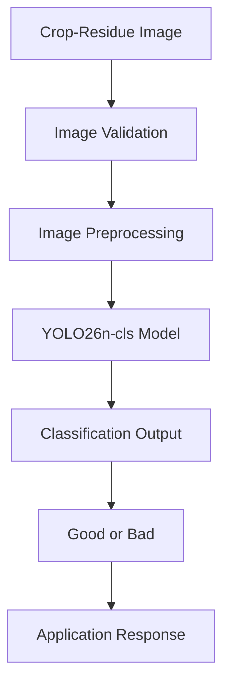
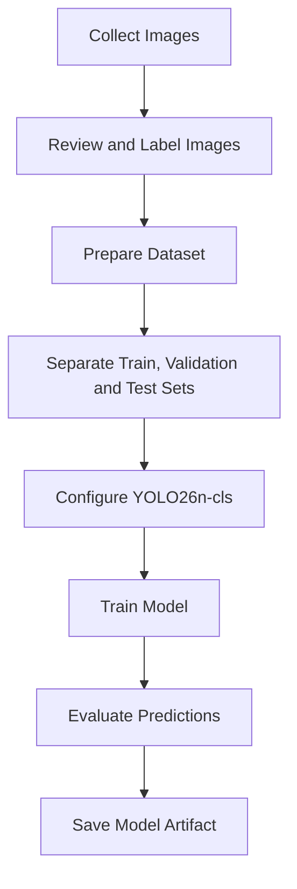
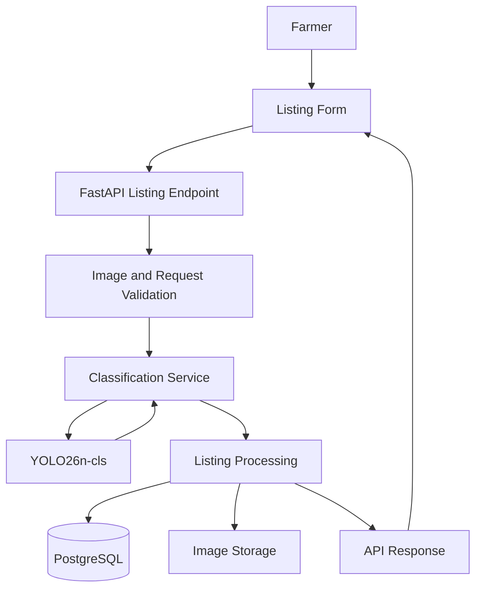
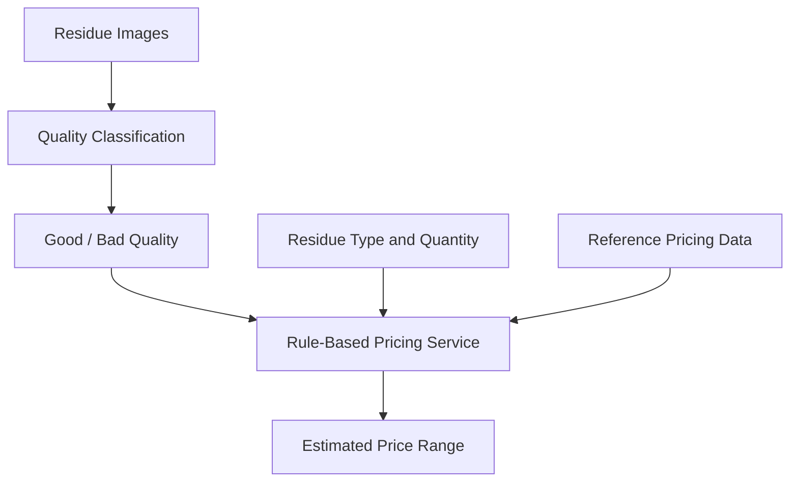

# AI and Machine Learning

## 1. Overview

Afyra uses artificial intelligence to support the assessment of agricultural crop residues submitted by farmers.

When a farmer creates a residue listing, the application collects images of the residue. The classification component is intended to help assess residue quality using visual information.

Afyra uses a YOLO26n-cls-based image classification approach.

The quality assessment has exactly two categories:

- **Good:** Residue classified as meeting the model's criteria for good quality.
- **Bad:** Residue classified as meeting the model's criteria for bad quality.

The model does not use intermediate quality categories such as excellent, average, or poor.

AI classification supports the listing workflow. It should not be treated as a complete physical or laboratory assessment of residue quality.

## 2. Purpose of the AI Component

The AI component is designed to:

1. Analyze uploaded crop-residue images.
2. Identify visual patterns associated with the supported quality categories.
3. Return a classification result.
4. Support consistent quality information in residue listings.
5. Provide information that can be used alongside the platform's pricing rules.

The AI component does not independently determine the final selling price.

Afyra's pricing functionality uses reference quotations and rule-based adjustments based on factors such as quality and quantity.

## 3. Model Architecture

### Model Type

| Property          | Description                     |
| ----------------- | ------------------------------- |
| Model             | YOLO26n-cls                     |
| Task              | Image classification            |
| Input             | Crop-residue images             |
| Output categories | Good and bad                    |
| Model family      | YOLO classification             |
| Application       | Crop-residue quality assessment |
| Integration       | Backend listing workflow        |

YOLO26n-cls is a classification model designed to assign an image to a learned category.

Unlike an object-detection model, an image-classification model predicts a class for an image rather than returning bounding boxes around detected objects.

### Model Processing Flow



This diagram describes the logical classification process. Exact preprocessing operations, image dimensions, confidence handling, and model-loading code must be confirmed from the implementation.

## 4. Image Collection

The Afyra listing API requires three photographs when creating a crop-residue listing.

| Image Field   | Description                                  |
| ------------- | -------------------------------------------- |
| `photo_macro` | Close-up image of the residue                |
| `photo_core`  | Image showing the inside of the pile or bale |
| `photo_base`  | Image showing the bottom of the pile         |

These images provide different visual views of the residue.

### Why Multiple Images Are Collected

A single image may not represent the condition of an entire pile or bale.

Different views can reveal visual differences that may not appear in one photograph.

For example:

- A close-up can show surface details.
- A core image can show material inside the pile.
- A base image can show the material near the bottom.

The API confirms that all three photographs are required for listing creation.

However, the API specification alone does not establish whether the model classifies each image separately, combines their predictions, or uses another aggregation method.

That behavior must be verified in the classification service.

## 5. Training Data

Training data is the collection of labeled images used to teach the model to distinguish between good and bad crop residues.

For a supervised classification model, each training image must have a known target label.

### Dataset Structure

A typical classification dataset may be organized as follows:

```text
dataset/
├── train/
│   ├── good/
│   └── bad/
├── val/
│   ├── good/
│   └── bad/
└── test/
    ├── good/
    └── bad/
```

This is an example of a suitable dataset structure, not a verified representation of Afyra's current training directory.

### Dataset Documentation Requirements

The project should record:

| Item               | Information Required                            |
| ------------------ | ----------------------------------------------- |
| Dataset source     | Where the images were obtained                  |
| Dataset size       | Total number of images                          |
| Class distribution | Number of good and bad images                   |
| Labeling process   | How image labels were assigned                  |
| Label verification | How incorrect or uncertain labels were reviewed |
| Training split     | Images used for model training                  |
| Validation split   | Images used during model development            |
| Test split         | Images reserved for final evaluation            |
| Image preparation  | Resizing, cleaning, and augmentation operations |
| Dataset version    | Dataset used for each model version             |

### Data Quality Considerations

Training images should represent the conditions in which farmers are expected to use Afyra.

Important variations include:

- Lighting conditions.
- Camera quality.
- Viewing angle.
- Background.
- Distance from the residue.
- Crop-residue appearance.
- Image sharpness.

Poor-quality or incorrectly labeled training images can reduce classification reliability.

### Current Dataset Evidence

The available documentation identifies the intended model and classification categories, but does not provide verified training image counts, dataset sources, or class distributions.

These values must be added from the actual dataset records.

## 6. Model Training

Model training allows the classification model to learn patterns associated with the two quality categories.

### General Training Process



### Training Configuration

The following information should be documented from the actual training configuration:

| Parameter       | Description                            | Verified Value |
| --------------- | -------------------------------------- | -------------- |
| Model weights   | Initial checkpoint used for training   | Not supplied   |
| Image size      | Input resolution used during training  | Not supplied   |
| Epochs          | Number of training passes              | Not supplied   |
| Batch size      | Images processed per training batch    | Not supplied   |
| Learning rate   | Training optimization setting          | Not supplied   |
| Optimizer       | Algorithm used to update model weights | Not supplied   |
| Training device | CPU or GPU environment                 | Not supplied   |
| Random seed     | Value used for reproducibility         | Not supplied   |
| Model artifact  | Saved trained checkpoint               | Not supplied   |

The documentation should not claim that a specific training configuration was used without the corresponding training script, configuration, or logs.

## 7. Model Evaluation

Model evaluation measures how well the classifier predicts quality categories on images that were not used for training.

Evaluation should use a separate labeled test dataset.

### Evaluation Metrics

| Metric           | What It Measures                                                 |
| ---------------- | ---------------------------------------------------------------- |
| Accuracy         | Percentage of images classified correctly                        |
| Precision        | How often predictions of a category are correct                  |
| Recall           | How many images belonging to a category are identified correctly |
| F1-score         | Balance between precision and recall                             |
| Confusion matrix | Counts of correct and incorrect predictions for each category    |

### Confusion Matrix

For a binary good/bad classifier, the confusion matrix can be represented as:

| Actual / Predicted | Good                        | Bad                        |
| ------------------ | --------------------------- | -------------------------- |
| Good               | Correctly classified good   | Incorrectly classified bad |
| Bad                | Incorrectly classified good | Correctly classified bad   |

This helps identify whether the model makes more errors in one category than the other.

### Evaluation Record

| Field                 | Result       |
| --------------------- | ------------ |
| Model version         | Not supplied |
| Evaluation date       | Not supplied |
| Number of test images | Not supplied |
| Accuracy              | Not supplied |
| Precision             | Not supplied |
| Recall                | Not supplied |
| F1-score              | Not supplied |
| Confusion matrix      | Not supplied |

No model performance percentage is reported because verified evaluation results have not been provided.

### Why Accuracy Alone Is Not Enough

Suppose the test dataset contains many good images and very few bad images.

A model could achieve high overall accuracy while performing poorly on bad-quality residue.

For this reason, evaluation should include per-class precision and recall, not only accuracy.

## 8. AI Integration With the Backend

The crop-residue classification component is associated with the listing workflow.

### Relevant API

```http
POST /residue_listings
```

The endpoint accepts multipart form data.

Required fields include:

```text
farm_id
residue_type_id
weight_kg
available_from
available_until
photo_macro
photo_core
photo_base
```

### Listing Response

The API's listing response schema includes fields such as:

```text
quality_grade
status
photos
price_per_kg_applied
total_payout_kes
```

Each photo record may include:

```text
photo_id
angle
quality_grade
screening_confidence
url
```

The `quality_grade` and `screening_confidence` fields can be null.

This is important because the frontend must not assume that every uploaded image has an available classification result.

### Integration Diagram



This is a conceptual integration diagram. The exact order of classification, image storage, and database writes must be confirmed from the backend source.

## 9. Prediction Handling

A classification result should be handled carefully by both the backend and frontend.

### Successful Classification

When the model successfully classifies an image, the application can use the returned quality category and any supported confidence information.

### Unavailable Classification

A classification may be unavailable because:

- The uploaded file is invalid.
- The image cannot be processed.
- The model artifact is unavailable.
- Inference fails.
- The service returns no usable prediction.

The frontend should display the appropriate state returned by the backend.

It should not automatically assign good quality when classification is missing.

### Confidence Scores

The API includes a `screening_confidence` field in the photo response.

A confidence score describes the model's reported confidence in its prediction.

It is not the same as a verified probability that the residue is physically safe or suitable for manufacturing.

The current API specification does not define a confidence threshold for accepting or rejecting predictions.

Any threshold used by the application must be documented from the actual inference code.

## 10. Misclassification Handling

A misclassification occurs when the model predicts a category different from the correct label.

For example, residue labeled as bad in a verified evaluation dataset might be predicted as good.

### Recommended Investigation Process

1. Identify the image associated with the incorrect prediction.
2. Record the expected quality category.
3. Record the predicted quality category.
4. Record the confidence score, if available.
5. Check image clarity and lighting.
6. Review whether the original label is correct.
7. Determine whether similar errors occur in other images.
8. Document the finding.
9. Correct the dataset, model, or application logic where appropriate.
10. Re-evaluate the affected behavior.

### Misclassification Record

| Field              | Description                              |
| ------------------ | ---------------------------------------- |
| Image reference    | Identifier or location of the test image |
| Expected category  | Good or bad                              |
| Predicted category | Good or bad                              |
| Confidence         | Model confidence, if available           |
| Model version      | Checkpoint used                          |
| Error description  | What went wrong                          |
| Investigation      | Possible cause                           |
| Resolution         | Action taken                             |
| Retest result      | Result after correction                  |

### User-Facing Handling

The application should avoid presenting a model prediction as a guaranteed quality certification.

If manual correction, review, or retry functionality exists, it should be documented using the implemented workflow.

The available API specification does not confirm a dedicated manual override endpoint.

## 11. Relationship Between AI and Pricing

Afyra's AI and pricing components have different responsibilities.

| Component               | Responsibility                                            |
| ----------------------- | --------------------------------------------------------- |
| AI classifier           | Supports image-based quality classification               |
| Pricing service         | Calculates a reference-based price estimate               |
| Residue listing service | Manages submitted residue information and listing records |

The pricing endpoint is:

```http
GET /prices/estimate
```

It accepts:

- `residue_type_id`
- `county`
- `weight_kg`
- `grade`

The `grade` parameter accepts:

```text
GOOD
POOR
```

The estimate response uses:

```text
good
bad
```

The pricing response includes the estimated minimum and maximum prices, source, and calculation method.

### Conceptual Flow



This illustrates how quality information can contribute to pricing. The exact connection between listing classification output and the pricing service must be confirmed from the implementation.

The model itself does not predict the final market price.

## 12. Model Limitations

Image classification has limitations that must be understood before using predictions in important decisions.

### Visual Information Only

A photograph cannot directly measure every physical or chemical property of crop residue.

The model should not be presented as a replacement for laboratory testing or expert inspection.

### Image Quality

Blurred, dark, overexposed, or poorly framed images can reduce classification reliability.

### Dataset Coverage

The model may perform differently on residue types, locations, or conditions that are not adequately represented in its training data.

### Incorrect Predictions

A model can produce an incorrect prediction even when it reports high confidence.

### Environmental Conditions

Lighting, moisture appearance, dust, shadows, and background objects may affect the visual information available to the classifier.

### Model Version Changes

Retraining or replacing the model can change its predictions.

Each deployed model should therefore have a documented version and evaluation record.

## 13. Model Monitoring and Maintenance

After deployment, the team should monitor the classification component for failures and changes in performance.

Useful monitoring information includes:

- Number of inference requests.
- Number of successful predictions.
- Number of failed predictions.
- Frequency of unavailable results.
- Prediction distribution between good and bad.
- Repeated misclassification reports.
- Model version used.
- Inference response time.

These are recommended monitoring indicators. Their actual collection must be verified in the deployed system.

### Model Update Process

When a new model version is prepared:

1. Review the updated training dataset.
2. Train or fine-tune the model.
3. Evaluate it on a separate test dataset.
4. Compare results with the previous model.
5. Review important misclassifications.
6. Verify backend compatibility.
7. Test the listing workflow.
8. Record the model version and evaluation results.
9. Deploy only after the required checks are complete.

## 14. AI Testing Checklist

- [ ] Confirm the correct model artifact is loaded.
- [ ] Confirm supported image formats.
- [ ] Test valid good-quality images.
- [ ] Test valid bad-quality images.
- [ ] Test corrupted images.
- [ ] Test unsupported file formats.
- [ ] Test unclear or low-quality images.
- [ ] Verify prediction output structure.
- [ ] Verify confidence handling.
- [ ] Verify behavior when inference fails.
- [ ] Verify backend listing integration.
- [ ] Record evaluation metrics.
- [ ] Review misclassification examples.
- [ ] Verify that missing predictions are not replaced with fabricated results.

Checklist items should only be marked complete after actual execution.

## 15. Documentation Evidence and Open Items

The following information must be verified from the model training files and backend implementation before the AI documentation can be considered complete.

| Area             | Missing Evidence                                            |
| ---------------- | ----------------------------------------------------------- |
| Dataset          | Source, size, class counts, and labeling process            |
| Training         | Training script, configuration, and logs                    |
| Model artifact   | Actual checkpoint name and version                          |
| Evaluation       | Accuracy, precision, recall, F1-score, and confusion matrix |
| Preprocessing    | Exact image transformations                                 |
| Inference        | Exact prediction and multi-image handling logic             |
| Confidence       | Thresholds and decision rules, if implemented               |
| Deployment       | Model-loading location and runtime configuration            |
| Failure handling | Implemented fallback, retry, or rejection behavior          |
| Monitoring       | Actual logs, metrics, and model-update process              |

These are documentation gaps, not confirmed implementation failures.

## 16. Related Documentation

- [System Architecture](/architecture/sad)
- [API Documentation](/backend/api-documentation)
- [Backend Overview](/backend/)
- [Frontend Mobile](/frontend-mobile/)
- [Developer Guide](/developer-guide/)
- [Testing and QA](/qa/)
- [Security](/security/)
- [Integrations](/integrations/)

## 17. References

- YOLO classification model documentation
