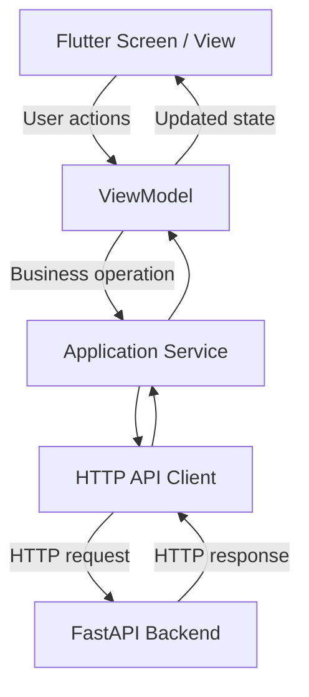
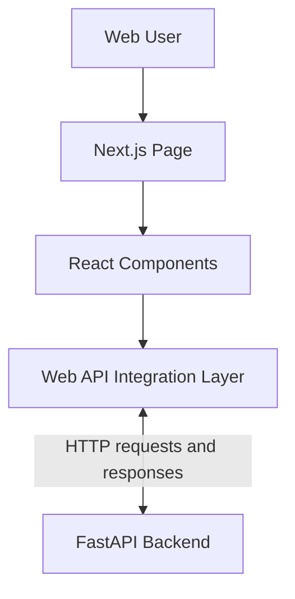
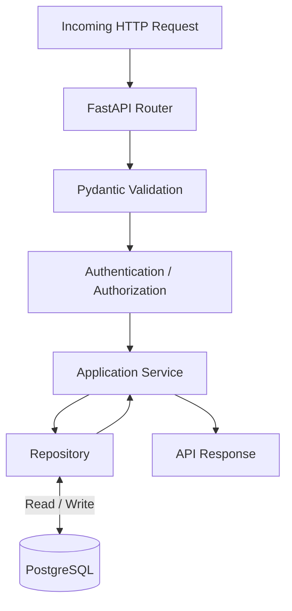
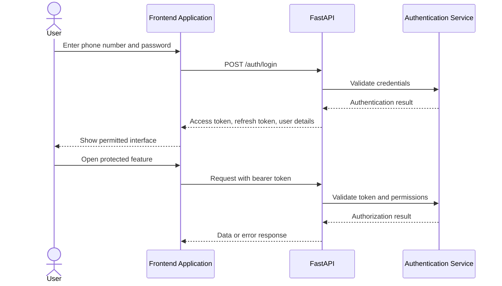
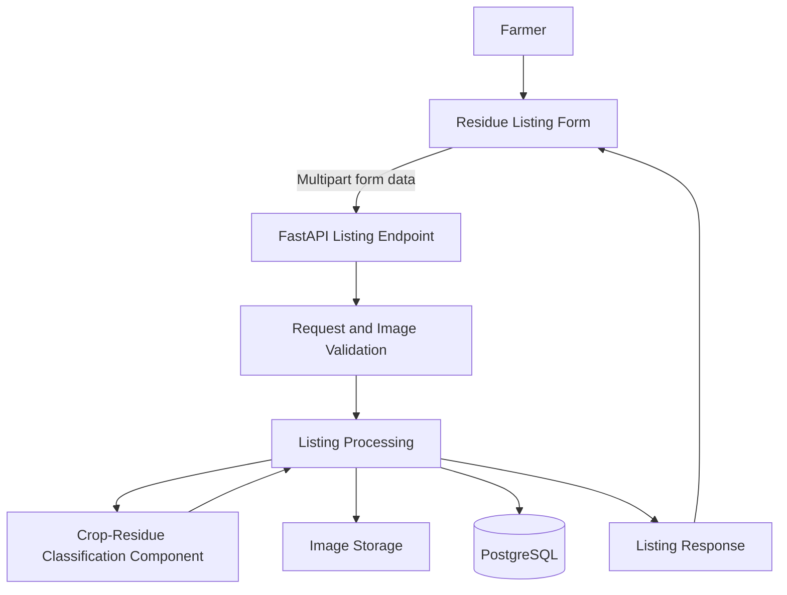
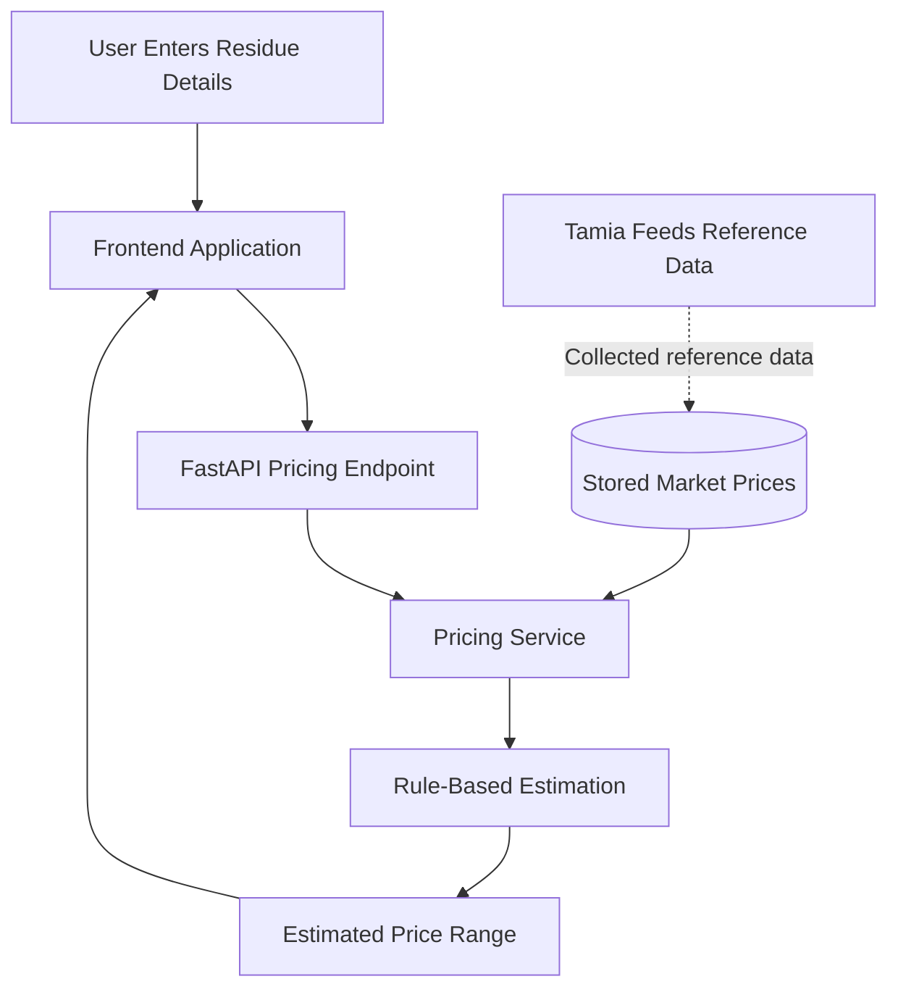
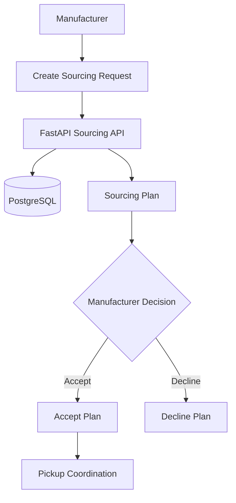
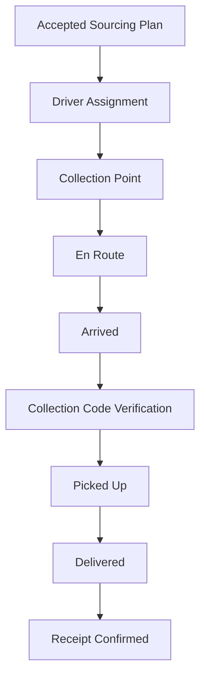

<script setup>
import { withBase } from 'vitepress'
</script>

# System Architecture

## 1. Introduction

Afyra is a digital platform that connects farmers who have agricultural crop residues with manufacturers who need those residues as raw materials.

The platform supports farm registration, crop-residue listings, quality assessment, price estimation, sourcing requests, and collection coordination.

Afyra uses a client-server architecture. The frontend applications provide interfaces for users, while the backend handles business logic, authentication, data processing, and communication with the database and external services.

The architecture separates responsibilities so that the mobile application, web application, backend, and supporting services can be developed and maintained independently.

## 2. Architecture Overview

Afyra consists of the following major components:

| Component           | Technology                     | Responsibility                                                        |
| ------------------- | ------------------------------ | --------------------------------------------------------------------- |
| Mobile application  | Flutter and Dart               | Provides mobile workflows for platform users                          |
| Web application     | Next.js, React, and TypeScript | Provides web-based workflows and dashboards                           |
| Backend API         | Python and FastAPI             | Handles requests, authentication, business logic, and data validation |
| Database            | PostgreSQL                     | Stores application records and relationships                          |
| Database migrations | Alembic                        | Manages database schema changes                                       |
| AI component        | YOLO26n-cls                    | Supports crop-residue image classification                            |
| Image storage       | AWS S3                         | Stores uploaded image files                                           |
| Pricing integration | Tamia Feeds                    | Provides reference information for residue pricing                    |
| Mapping integration | Google Maps                    | Supports location-related functionality                               |
| SMS integration     | SMS Leopard                    | Supports phone-based communication                                    |

The components work together through defined interfaces rather than directly sharing application logic.

## 3. System Architecture Diagram (SAD)

The diagram below is Afyra's original System Architecture Diagram. It is the primary visual reference for the platform. The explanations in this document describe its components and how they work together; they do not replace the original design.


### 3.1 Frontend Applications

Afyra has two frontend applications:

- **Flutter mobile application:** Provides mobile screens and workflows for interacting with Afyra.
- **Next.js web application:** Provides browser-based pages, forms, and dashboards.

Both applications send requests to the FastAPI backend and display the results. They do not access PostgreSQL directly. The applications can present different user experiences while sharing the same backend rules and data.

### 3.2 FastAPI Backend

FastAPI is the central application interface. It receives requests from the mobile and web applications, validates inputs, checks permissions where required, applies business rules, and returns responses.

The backend documentation describes its logical responsibilities as **API routers**, **Pydantic schemas**, **application services**, and **repositories**. Routers expose operations; schemas validate data; services coordinate business operations; and repositories manage structured database access. This is an explanation of the backend's responsibilities, not a claim that every request follows exactly the same internal path.

### 3.3 PostgreSQL and Alembic

PostgreSQL holds structured records such as user accounts, farms, residue listings, reference prices, sourcing requests, and pickup information. Relationships between these records allow the platform to connect a listing to its farm, or a pickup to its sourcing workflow. Alembic manages changes to the database schema.

### 3.4 AI Classification and Image Storage

The YOLO26n-cls component supports crop-residue image classification. A residue-listing submission includes three photos: `photo_macro`, `photo_core`, and `photo_base`. AWS S3 is the image-storage integration. The exact sequence of image validation, storage, model inference, and database updates must be checked against the current backend implementation; the diagram should not be read as a guarantee of execution order.

### 3.5 Pricing and Other External Services

- **Tamia Feeds:** Provides supplier reference quotations used by the rule-based pricing process. This does not mean the backend makes a live supplier call for every estimate.
- **SMS Leopard:** Supports phone-based messaging workflows.
- **Google Maps:** Supports location-related functionality. Whether a particular map request is made by the frontend or backend must be confirmed from the implementation.

External services are integrations, not replacements for Afyra's backend or database.

### 3.6 How Data Moves Through the Architecture

1. A user performs an action in the Flutter or Next.js application.
2. The application sends the relevant request to FastAPI.
3. FastAPI validates the request and checks authentication or permissions when required.
4. The relevant business logic reads or updates PostgreSQL and, where necessary, coordinates with the AI component, image storage, or another external service.
5. FastAPI returns a response or an appropriate error.
6. The frontend updates the screen to show the result.

For example, a farmer's residue-listing request carries farm and residue details together with three photographs. The backend handles the request and the associated listing workflow. The AI and image-storage components have separate responsibilities within that workflow. Their precise invocation order remains an implementation detail to verify.

### 3.7 Scope of the Diagram

The SAD explains **which major components exist and how they are connected**. It does not, by itself, prove the internal algorithm of a sourcing plan, the exact AI execution sequence, the storage location of frontend tokens, or the current hosting arrangement. Those details are addressed in the relevant sections below and should be verified against the code and deployment settings.

## 4. Frontend Architecture

Afyra has two frontend applications that communicate with the backend through HTTP APIs.

### 4.1 Flutter Mobile Application

The Flutter application uses the Model-View-ViewModel (MVVM) architecture.

MVVM separates the user interface from the logic that manages application state and data.



**Views**

Views display information, collect user input, and respond to user interactions.

Examples include authentication forms, farm registration screens, and residue-listing interfaces.

**ViewModels**

ViewModels manage screen state, including loading, success, empty, and error conditions.

They coordinate application services without placing HTTP request logic directly in widgets.

**Services**

Services contain frontend operations that communicate with backend endpoints.

For example, a catalog service retrieves residue types from the FastAPI API.

**API Client**

The API client handles HTTP communication and passes responses or errors back to services.

This separation makes mobile features easier to test and maintain.

### 4.2 Next.js Web Application

The web application uses Next.js, React, and TypeScript.

Its main architectural responsibilities include:

- Rendering web pages and dashboards.
- Collecting and validating user input.
- Managing frontend state.
- Calling backend endpoints.
- Displaying information returned by the API.
- Handling authentication and authorization-related user experiences.



Where the existing web application uses Next.js route handlers, these can forward requests to FastAPI.

The web application should follow its established API and session-management implementation rather than introducing separate authentication mechanisms.

### 4.3 Shared Backend

Both frontend applications use the same backend API.

This avoids duplicating backend business rules for mobile and web users.

For example, residue-price calculations are performed by the backend rather than independently calculating prices in Flutter and Next.js.

## 5. Backend Architecture

The FastAPI backend organizes application responsibilities into separate layers.



The diagram illustrates a typical protected database-backed request. Public endpoints do not require the same authentication checks, and some services use external integrations instead of database repositories.

### 5.1 API Routers

Routers define the available HTTP endpoints.

They specify:

- Request methods.
- URL paths.
- Request parameters.
- Response schemas.
- Required dependencies.

For example, the catalog router includes:

```text
GET /counties
GET /residue-types
GET /prices/quote
GET /prices/estimate
POST /admin/residue-types
```

Other backend routers support authentication, farms, residue listings, sourcing requests, pickups, drivers, and administration.

The complete route reference is available in Swagger.

### 5.2 Pydantic Schemas

Pydantic schemas define the structure of incoming and outgoing data.

They help ensure that:

- Required fields are present.
- Values use supported data types.
- Numeric constraints are respected.
- Invalid input is rejected.
- Responses follow consistent structures.

For example, the pricing estimate endpoint requires a positive `weight_kg` value.

### 5.3 Application Services

Services implement the business rules used by API endpoints.

Their responsibilities include:

- Applying pricing rules.
- Managing resource creation and updates.
- Coordinating database operations.
- Processing sourcing and collection workflows.
- Calling external services when required.

Separating business logic from routers makes it easier to reuse and test.

### 5.4 Repositories

Repositories manage database access.

They allow services to retrieve, create, and update records without embedding database queries directly into API route handlers.

### 5.5 Database

PostgreSQL stores the platform's structured application data.

The backend uses database relationships to connect information such as:

- User accounts and roles.
- Farms.
- Residue types.
- Residue listings.
- Market prices.
- Sourcing requests.
- Drivers.
- Pickups.
- Collection points.

The exact tables, keys, and relationships are documented in the Entity Relationship Diagram and database models.

Alembic is used to manage database schema migrations.

## 6. Authentication and Authorization Architecture

Afyra uses authentication to identify users and authorization to determine which operations they can perform.

The API specification defines HTTP bearer-token authentication.

### Authentication Flow



### Supported Roles

The API defines the following account roles:

| Role         | Responsibility                             |
| ------------ | ------------------------------------------ |
| FARMER       | Farm and residue-listing workflows         |
| MANUFACTURER | Sourcing and manufacturing workflows       |
| DRIVER       | Assigned collection and delivery workflows |
| ADMIN        | Administrative operations                  |

The user schema also includes `is_super_admin` for identifying a super administrator.

The super administrator is responsible for inviting administrators.

### Access Control

Protected endpoints require an access token.

Role restrictions are enforced in the backend.

For example:

- Farmers and manufacturers can register their own accounts.
- Driver accounts are created through the invitation workflow.
- Administrator invitations require super-administrator authorization.
- Administrative endpoints restrict access to authorized accounts.

Frontend navigation can hide unavailable features, but the backend remains responsible for enforcing access rules.

## 7. Crop-Residue Listing and AI Architecture

The residue-listing workflow allows a farmer to provide information about available crop residue.

The API supports creating a listing using multipart form data.

The request includes:

- `farm_id`
- `residue_type_id`
- `weight_kg`
- `available_from`
- `available_until`
- `photo_macro`
- `photo_core`
- `photo_base`

The three image fields represent different views of the residue:

| Image         | Purpose                 |
| ------------- | ----------------------- |
| `photo_macro` | Close-up of the residue |
| `photo_core`  | Inside the pile or bale |
| `photo_base`  | Bottom of the pile      |

### Listing and Classification Flow



This is a logical component diagram. The exact order of image storage, model inference, and database writes must be confirmed from the listing service implementation.

### AI Component

Afyra uses a YOLO26n-cls-based classification component.

Its purpose is to support the assessment of uploaded crop-residue images.

The listing response schema can include:

- `quality_grade`
- `screening_confidence`
- Photo information.
- Listing status.

These fields should not be interpreted as proof that every submitted image is classified successfully.

Classification failures, invalid images, and unavailable model artifacts must be handled according to the implemented backend behavior.

Model training, evaluation, limitations, and misclassification handling are covered in the AI documentation.

## 8. Pricing Architecture

Afyra provides crop-residue pricing through reference quotations and rule-based estimates.

The backend exposes two important endpoints:

```text
GET /prices/quote
GET /prices/estimate
```

### Price Quote

The quote endpoint retrieves an available reference price for a residue type and county.

The response includes:

- Residue type.
- County.
- Price per kilogram, if available.
- Effective date.
- Stale-price indicator.
- Price source, if available.

A price is considered stale when it is more than 90 days old.

### Price Estimate

The estimate endpoint uses:

- Residue type.
- County.
- Weight in kilograms.
- Quality grade.

The request accepts `GOOD` and `POOR`, while the response represents quality as `good` or `bad`.

### Pricing Data Flow



The supplier connection represents the reference-price collection workflow. It does not imply that a live supplier request is made every time a user requests an estimate.

### Pricing Limitations

Estimated prices are not guaranteed selling prices.

If reference data is unavailable, the frontend should show the unavailable state returned by the backend.

It must not replace missing prices with fabricated amounts.

## 9. Manufacturer Sourcing Architecture

Manufacturers use sourcing requests to specify the residue they need.

The backend supports creating, listing, retrieving, and managing sourcing requests.

A sourcing request can include:

- Residue type.
- Required quantity.
- Required delivery date.
- Minimum quality grade.
- Desired price per kilogram.
- Delivery coordinates.
- Maximum sourcing distance.

### Sourcing Workflow



The API supports request statuses including:

- `OPEN`
- `PLAN_PROPOSED`
- `PLAN_ACCEPTED`
- `IN_PROGRESS`
- `COMPLETED`
- `CANCELLED`

The diagram represents the supported workflow at a high level. It does not specify the internal algorithm used to generate sourcing plans.

## 10. Collection and Driver Architecture

Afyra provides endpoints for coordinating pickups and tracking delivery-related progress.

The backend includes operations for:

- Assigning drivers.
- Listing pickups.
- Viewing pickup tracking information.
- Viewing a driver's assigned pickups.
- Updating driver location.
- Managing collection-point status.
- Verifying collection codes.
- Recording loaded and delivered quantities.
- Confirming receipt.

### Collection Flow



This illustrates the business progression represented by the collection and pickup endpoints. The precise allowed status transitions are determined by backend business rules.

### Driver Location

The API includes:

```text
PUT /drivers/me/location
```

The request contains latitude and longitude.

The response includes the recorded location and timestamp.

Location information should be accessible only to authorized users and used for the intended pickup and delivery workflows.

## 11. External Integrations

Afyra uses external services to support specific platform operations.

| Integration | Purpose           | Architectural Role                                |
| ----------- | ----------------- | ------------------------------------------------- |
| AWS S3      | Image storage     | Stores uploaded residue images                    |
| Tamia Feeds | Pricing reference | Supplies information used by the pricing workflow |
| SMS Leopard | SMS communication | Supports phone-based messaging                    |
| Google Maps | Mapping           | Supports location-related features                |

### Integration Boundaries

External services are separate from the main application database.

A failure in an external service should be handled without exposing sensitive system details.

For example:

- If an SMS cannot be sent, the backend should report or record the failure appropriately.
- If a supplier price is unavailable, the pricing workflow should not invent a value.
- If an image upload fails, the user should receive an understandable error.
- If a map service is unavailable, the application should handle the unavailable map functionality.

The exact retry behavior, provider configuration, and operational status must be verified in the integration implementation.

## 12. Data Flow and Storage

PostgreSQL stores structured records, while image files are handled through the configured image-storage workflow.

### Structured Data

Examples include:

- User details.
- Farm details.
- Residue listings.
- Pricing records.
- Sourcing requests.
- Pickup assignments.
- Collection records.

### Image Data

Residue images are submitted through multipart requests.

The application can associate stored image references with their corresponding listing records.

### Data Flow Principles

The architecture follows these principles:

1. Frontends submit data through API endpoints.
2. The backend validates submitted data.
3. Business services enforce application rules.
4. Repositories manage structured database operations.
5. External services are accessed through the appropriate integration logic.
6. API responses return the information needed by the frontend.

Frontend applications should not connect directly to PostgreSQL.

## 13. Error Handling

The Afyra OpenAPI specification defines a common error response structure for many endpoints:

```json
{
  "error": {
    "code": "EXAMPLE_ERROR",
    "message": "A description of the problem",
    "details": null
  }
}
```

The values shown are illustrative.

The backend also documents validation-error responses for some endpoints using FastAPI's standard validation structure.

### Common HTTP Status Codes

| Code | Meaning                                   |
| ---- | ----------------------------------------- |
| 200  | Request succeeded                         |
| 201  | Resource created                          |
| 204  | Request succeeded without a response body |
| 400  | Bad request                               |
| 401  | Authentication failed or is required      |
| 403  | Access forbidden                          |
| 404  | Resource not found                        |
| 409  | Conflict                                  |
| 422  | Request validation failed                 |
| 429  | Too many requests                         |
| 500  | Unexpected server error                   |

The frontend should translate these responses into useful messages while avoiding exposure of internal implementation details.

## 14. Security Architecture

Security is enforced at multiple layers.

### Frontend

- Collects user credentials through authentication interfaces.
- Sends protected requests using the configured authentication mechanism.
- Handles session expiration and authentication errors.
- Restricts visible features according to the user experience.

### Backend

- Validates authentication tokens.
- Enforces role-based permissions.
- Validates incoming requests.
- Controls access to database records.
- Handles errors without intentionally exposing sensitive internal information.

### Database

- Stores structured application data.
- Uses defined relationships and constraints.
- Receives application queries through backend database access logic.

### External Services

- Require appropriate configuration and credentials.
- Should not expose secret keys in frontend source code or public documentation.
- Must handle provider failures safely.

The security documentation should include actual implementation evidence, configuration requirements, and security test results.

## 15. Architectural Design Decisions

### Shared Backend

Both frontend applications use FastAPI.

**Reason:** Business rules, validation, and data access can be managed centrally.

### Separate Frontend Applications

Afyra uses Flutter and Next.js for different interfaces.

**Reason:** Each application can support its intended user workflows while sharing backend services.

### Layered Backend

The backend separates routers, schemas, services, and repositories.

**Reason:** Each layer has a clear responsibility, improving maintainability and testability.

### PostgreSQL

Structured application records are stored in PostgreSQL.

**Reason:** The platform requires relational data, constraints, and relationships between users, farms, listings, and sourcing activities.

### Separate Image Storage

Images are handled through an external storage integration.

**Reason:** Uploaded files can be managed separately from structured database records.

### Rule-Based Pricing

The backend calculates estimates from reference pricing data and defined adjustment rules.

**Reason:** The system can explain the inputs used to produce a price estimate without presenting it as a guaranteed market transaction price.

## 16. Deployment Architecture

The frontend applications, backend, database, and integrations must be configured for the intended deployment environment.

The known hosted backend address is:

```text
https://afyra-def6d466c54b.herokuapp.com
```

The following deployment details should be confirmed from the actual hosting configuration before documenting them as facts:

- Current Flutter application distribution method.
- Current Next.js hosting provider.
- PostgreSQL hosting provider.
- AWS S3 bucket configuration.
- Production environment variables.
- Domain and HTTPS configuration.
- Automated deployment pipelines.
- Monitoring and logging services.

No specific infrastructure configuration is assumed where supporting deployment evidence is unavailable.

## 17. Architecture Limitations and Verification

The original SAD is preserved in Section 3. The smaller diagrams in later sections illustrate logical workflows based on the documented architecture and API contracts; they do not establish the exact execution sequence of every implementation.

Some implementation details still require verification against the current source code:

| Area           | Detail to Verify                                                          |
| -------------- | ------------------------------------------------------------------------- |
| Google Maps    | Whether maps are accessed directly by clients or through backend services |
| AI inference   | Exact model invocation and error-handling sequence                        |
| Image uploads  | Exact order of validation, inference, storage, and database writes        |
| Sourcing plans | Internal plan-generation logic                                            |
| Authentication | Token storage and refresh handling in each frontend                       |
| Deployment     | Current hosting and infrastructure configuration                          |
| Integrations   | Retry behavior, timeouts, and failure recovery                            |

These are documentation verification items, not confirmed application defects.

## 18. Related Documentation

- [Developer Guide](/developer-guide/)
- [API Documentation](/backend/api-documentation)
- [Backend Overview](/backend/)
- [Frontend Mobile](/frontend-mobile/)
- [Frontend Web](/frontend-web/)
- [ERD and Data Models](/architecture/data-models)
- [AI Documentation](/ai/)
- [Security](/security/)
- [Integrations](/integrations/)
- [Testing and Quality Assurance](/qa/)

## 19. References

- [Afyra Swagger API Reference](https://afyra-def6d466c54b.herokuapp.com/docs)
- FastAPI backend routers and Pydantic schemas
- Flutter mobile application documentation
- Next.js web application documentation
