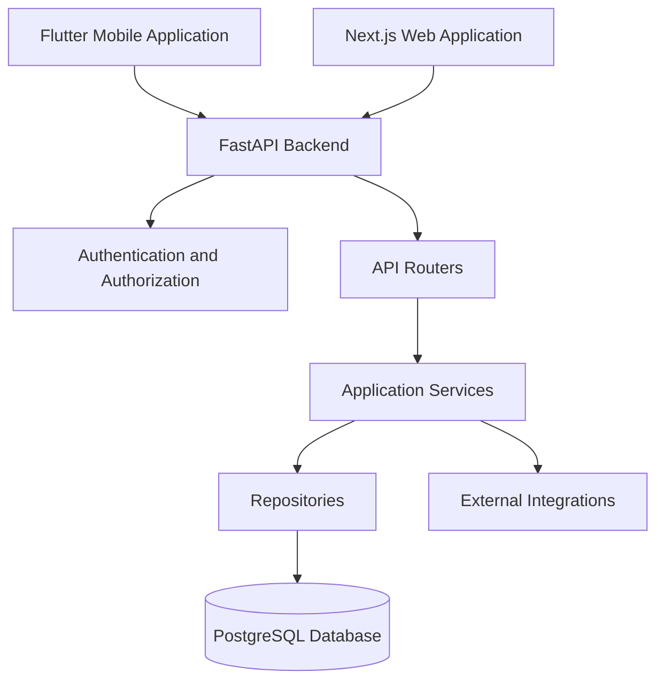
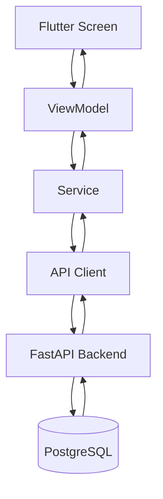

# API Documentation

## 1. Overview

The Afyra API connects the Flutter mobile application and Next.js web application to the FastAPI backend and PostgreSQL database.

It provides the operations needed for authentication, farm management, crop-residue listings, pricing, sourcing, collection coordination, and administration.

The API uses REST principles, JSON request and response bodies, and Pydantic for data validation.

This documentation focuses on the main API groups and representative examples. It does not repeat every endpoint because the complete API reference is available through Swagger UI.

## 2. API Access

### Base URLs

| Environment       | URL                                        |
| ----------------- | ------------------------------------------ |
| Local development | `http://127.0.0.1:8000`                    |
| Hosted API        | `https://afyra-def6d466c54b.herokuapp.com` |

The local URL assumes FastAPI is running on its default port. The hosted URL is the project's documented deployment address.

### Interactive API Documentation

FastAPI automatically generates interactive API documentation.

- **Swagger UI:** [Afyra API Documentation](https://afyra-def6d466c54b.herokuapp.com/docs)
- **Local Swagger:** `http://127.0.0.1:8000/docs`
- **OpenAPI Schema:** `/openapi.json`

Swagger allows developers to:

1. Explore available endpoints.
2. View required request parameters.
3. Examine request and response schemas.
4. Authenticate protected requests.
5. Execute API requests.
6. Inspect status codes and error responses.

For the complete endpoint reference, use Swagger UI.

## 3. API Architecture

The frontend applications communicate with the backend using HTTP requests.



### Request Processing

A typical API request follows these steps:

1. The frontend sends an HTTP request.
2. FastAPI identifies the requested endpoint.
3. Pydantic validates the submitted data.
4. Authentication and authorization checks run where required.
5. The endpoint calls the appropriate service.
6. The service processes the request and accesses the database or an integration when needed.
7. The backend returns a response.
8. The frontend updates the interface.

This separation keeps business logic in the backend rather than duplicating it across frontend applications.

## 4. Authentication and Authorization

Afyra restricts access to protected endpoints based on authentication and user roles.

The backend uses dependencies to identify authenticated users and enforce administrator access.

| Access Level  | Description                                                                   |
| ------------- | ----------------------------------------------------------------------------- |
| Public        | Accessible without authentication                                             |
| Authenticated | Requires a valid user session or access token                                 |
| Administrator | Requires an authenticated user with the appropriate administrator permissions |

### Authenticated Requests

For endpoints using bearer-token authentication, the request includes:

```http
Authorization: Bearer ACCESS_TOKEN
```

Example:

```bash
curl -X GET \
  "http://127.0.0.1:8000/prices/quote?residue_type_id=1&county=Nakuru" \
  -H "Authorization: Bearer ACCESS_TOKEN"
```

Replace `ACCESS_TOKEN` with a valid token obtained through the backend's authentication workflow.

### Role-Based Access

Different roles have access to different operations.

For example:

- Farmers use farm and residue-listing workflows.
- Manufacturers use sourcing-related workflows.
- Drivers use assigned collection and delivery workflows.
- Administrators manage restricted platform resources.

Access is enforced by backend authorization rules, not only by hiding buttons in the frontend.

### Authentication Errors

| Status Code      | Meaning                                                    |
| ---------------- | ---------------------------------------------------------- |
| 401 Unauthorized | Authentication is missing, invalid, or expired             |
| 403 Forbidden    | The user does not have permission to perform the operation |

The exact authentication request and token response schemas are available in Swagger.

## 5. Main API endpoints

The API is organized around the platform's main features.

| API endpoints      | Responsibility                                                       |
| ------------------ | -------------------------------------------------------------------- |
| Authentication     | User registration, login, verification, and authentication workflows |
| Users and Profiles | Account information and role-specific profile operations             |
| Farms              | Farm registration and retrieval                                      |
| Residue Catalog    | Available crop-residue types                                         |
| Pricing            | Market-price quotations and quality-based estimates                  |
| Residue Listings   | Farmer residue availability and listing management                   |
| Sourcing           | Manufacturer residue sourcing requests                               |
| Collections        | Collection-point and pickup coordination                             |
| Drivers            | Driver-related operations                                            |
| Notifications      | Platform communication and updates                                   |
| Administration     | Restricted management operations                                     |

Not every API group supports full create, read, update, and delete operations.

Developers should consult Swagger to confirm the exact HTTP methods, permissions, and schemas.

## 6. Representative API Examples

The following examples demonstrate how important Afyra workflows communicate with the backend.

Values used in examples are illustrative and do not represent live database records.

### 6.1 Retrieve Residue Types

**Endpoint**

```http
GET /residue-types
```

**Purpose**

Retrieves the crop-residue types available in Afyra's database.

**Authentication:** Public.

**Request**

```bash
curl -X GET \
  "http://127.0.0.1:8000/residue-types"
```

**Successful Response — HTTP 200**

```json
[
  {
    "residue_type_id": 1,
    "name": "Maize stalks"
  }
]
```

**Response Fields**

| Field             | Type    | Description                    |
| ----------------- | ------- | ------------------------------ |
| `residue_type_id` | Integer | Unique residue type identifier |
| `name`            | String  | Residue type name              |

If no residue types exist, the endpoint returns:

```json
[]
```

An empty array is a successful response, not a server error.

The frontend should display an appropriate empty state rather than using fabricated residue records.

### 6.2 Register a Farm

**Endpoint**

```http
POST /farms
```

**Purpose**

Allows a farmer to register a farm.

**Request Body Example**

```json
{
  "farm_name": "Example Farm",
  "county": "Nakuru",
  "latitude": "-0.3031",
  "longitude": "36.0800",
  "location_description": "Example location",
  "can_host": false
}
```

The example follows the fields used by the current Flutter farm-registration integration.

**Important Validation Requirements**

- The farm name and county must match the backend's expected schema.
- Latitude and longitude are sent using decimal-string representations.
- The request must satisfy the backend's farm-registration validation and authorization requirements.

An invalid payload may return HTTP `422 Unprocessable Entity`.

The exact successful response structure should be taken from the farm endpoint's Swagger schema.

### 6.3 Manage Farm Collection Hosting

Collection-hosting availability is stored separately for each registered farm.

A farmer can enable or disable hosting without changing their account registration.

**Endpoints:**

| Method | Endpoint           | Purpose                                   |
| ------ | ------------------ | ----------------------------------------- |
| GET    | `/farms`           | Retrieve the authenticated farmer's farms |
| GET    | `/farms/{farm_id}` | Retrieve an individual farm               |
| PATCH  | `/farms/{farm_id}` | Update permitted farm details             |

**Enable hosting:**

```http
PATCH /farms/{farm_id}
Authorization: Bearer ACCESS_TOKEN
Content-Type: application/json
```

```json
{
  "can_host": true
}
```

**Disable hosting:**

```json
{
  "can_host": false
}
```

The API returns the updated farm, including its saved `can_host` value.

The farmer can manage hosting separately for each farm under **My farms** in the mobile application.

The backend may reject disabling hosting when the farm is associated with an unfinished hosted pickup. The mobile application must display the error and retain the previously saved status.

Only authenticated farmers can access these farm-management endpoints.

### 6.4 Retrieve a Price Quote

**Endpoint**

```http
GET /prices/quote
```

**Purpose**

Returns an available price quotation for a residue type in a selected county.

**Authentication:** Required.

**Query Parameters**

| Parameter         | Type    | Required |
| ----------------- | ------- | -------- |
| `residue_type_id` | Integer | Yes      |
| `county`          | String  | Yes      |

**Request**

```bash
curl -X GET \
  "http://127.0.0.1:8000/prices/quote?residue_type_id=1&county=Nakuru" \
  -H "Authorization: Bearer ACCESS_TOKEN"
```

**Response Example — HTTP 200**

```json
{
  "residue_type_id": 1,
  "county": "Nakuru",
  "rate_kes_per_kg": "12.50",
  "effective_date": "2026-10-01",
  "is_stale": false,
  "source": "Illustrative reference source"
}
```

The price and source are examples, not verified supplier quotations.

**Response Fields**

| Field             | Description                                       |
| ----------------- | ------------------------------------------------- |
| `residue_type_id` | Residue type identifier                           |
| `county`          | Selected county                                   |
| `rate_kes_per_kg` | Available price per kilogram in KES               |
| `effective_date`  | Date associated with the price                    |
| `is_stale`        | Indicates whether the price is older than 90 days |
| `source`          | Price reference source                            |

When no price is available, `rate_kes_per_kg` may be `null`.

The frontend should show an unavailable-price message instead of displaying a made-up value.

### 6.5 Calculate a Price Estimate

**Endpoint**

```http
GET /prices/estimate
```

**Purpose**

Calculates an estimated crop-residue price range based on residue type, location, quantity, and quality.

**Authentication:** Required.

**Query Parameters**

| Parameter         | Type    | Required | Validation                           |
| ----------------- | ------- | -------- | ------------------------------------ |
| `residue_type_id` | Integer | Yes      | Residue type identifier              |
| `county`          | String  | Yes      | County                               |
| `weight_kg`       | Decimal | Yes      | Greater than zero                    |
| `grade`           | String  | No       | `GOOD` or `POOR`; defaults to `GOOD` |

Afyra uses two quality categories: **good** and **bad**.

The backend accepts `GOOD` and `POOR` as request values and returns `good` or `bad` in the estimate response.

**Request**

```bash
curl -X GET \
  "http://127.0.0.1:8000/prices/estimate?residue_type_id=1&county=Nakuru&weight_kg=100&grade=GOOD" \
  -H "Authorization: Bearer ACCESS_TOKEN"
```

**Response Example — HTTP 200**

```json
{
  "residue_type_id": 1,
  "residue_category": "Illustrative category",
  "quality": "good",
  "weight_kg": "100",
  "adjustment_points": 0,
  "estimated_min_kes_per_kg": "10.00",
  "estimated_max_kes_per_kg": "14.00",
  "estimated_total_min_kes": "1000.00",
  "estimated_total_max_kes": "1400.00",
  "source": "Illustrative reference",
  "method": "Illustrative calculation",
  "is_estimate": true
}
```

All amounts are illustrative, not actual Afyra calculations.

**Important Response Fields**

| Field                      | Description                              |
| -------------------------- | ---------------------------------------- |
| `quality`                  | Good or bad                              |
| `weight_kg`                | Quantity being estimated                 |
| `estimated_min_kes_per_kg` | Lower estimated rate                     |
| `estimated_max_kes_per_kg` | Upper estimated rate                     |
| `estimated_total_min_kes`  | Lower estimated total                    |
| `estimated_total_max_kes`  | Upper estimated total                    |
| `source`                   | Pricing reference                        |
| `method`                   | Estimation method                        |
| `is_estimate`              | Indicates that the result is an estimate |

The estimated price is not a guaranteed transaction price.

### 6.6 Farmer Account Management

Afyra allows authenticated users to update their names and change their passwords.

#### Update Profile

**Endpoint:** `PATCH /users/me`

**Authentication:** Required.

**Request example:**

```json
{
  "first_name": "Amina",
  "last_name": "Mwangi"
}
```

Both fields are optional, but supplied names must not be empty.

The endpoint returns the updated user profile.

The current endpoint does not support changing the user's phone number or email address.

#### Change Password

**Endpoint:** `POST /users/me/password`

**Authentication:** Required.

**Request example:**

```json
{
  "current_password": "CURRENT_PASSWORD",
  "new_password": "NEW_PASSWORD"
}
```

The new password must contain at least eight characters.

The backend verifies the current password before saving the new one.

A successful password change invalidates the user's existing authentication tokens. The user must sign in again.

## 7. Request Validation

FastAPI uses Pydantic schemas to validate incoming data.

Validation checks may include:

- Required fields
- Correct data types
- Allowed values
- String length limits
- Positive numeric values
- Date formats
- Valid county names

### Example: Invalid Weight

```http
GET /prices/estimate?residue_type_id=1&county=Nakuru&weight_kg=0
```

The backend rejects this request because `weight_kg` must be greater than zero.

A typical FastAPI validation response follows this structure:

```json
{
  "detail": [
    {
      "type": "greater_than",
      "loc": ["query", "weight_kg"],
      "msg": "Input should be greater than 0",
      "input": "0",
      "ctx": {
        "gt": 0
      }
    }
  ]
}
```

The exact response may differ depending on the installed FastAPI and Pydantic versions.

Frontend applications should use validation errors to explain what the user needs to correct.

## 8. HTTP Status Codes and Error Handling

Afyra uses HTTP status codes to indicate whether an API request succeeded or failed.

| Status Code               | Meaning                            | Example                          |
| ------------------------- | ---------------------------------- | -------------------------------- |
| 200 OK                    | Request succeeded                  | Fetching residue types           |
| 201 Created               | Resource created                   | Creating a residue type          |
| 400 Bad Request           | Request rejected                   | Business-rule validation         |
| 401 Unauthorized          | Authentication required or invalid | Missing credentials              |
| 403 Forbidden             | Insufficient permissions           | Accessing an admin-only endpoint |
| 404 Not Found             | Resource not found                 | Requested record does not exist  |
| 422 Unprocessable Entity  | Invalid request data               | Invalid weight or missing field  |
| 500 Internal Server Error | Unexpected backend failure         | Unhandled server error           |

Some errors depend on the endpoint's service logic and exception handlers.

### Frontend Error Handling

The frontend should handle:

1. **Loading:** Show progress while waiting for the API.
2. **Success:** Display the returned information.
3. **Empty data:** Explain that no records are available.
4. **Validation failure:** Show a clear message about invalid input.
5. **Authentication failure:** Ask the user to authenticate again when necessary.
6. **Authorization failure:** Explain that the operation is not permitted.
7. **Network failure:** Allow the user to retry.
8. **Server failure:** Display a safe error message without exposing internal details.

## 9. Frontend API Integration

### Flutter Mobile Application

The Flutter application follows the MVVM architecture.



**Responsibilities**

- Screens display information and collect input.
- ViewModels manage loading, success, and error states.
- Services call the appropriate backend endpoints.
- The shared API client manages HTTP communication.

For example, the catalog screen requests residue types through its Catalog ViewModel and Catalog Service.

The frontend should not bypass the existing service layer.

### Next.js Web Application

The Next.js application communicates with FastAPI through its configured API integration layer.

Where server-side route handlers are used, they can forward requests to the backend while keeping sensitive authentication information away from browser JavaScript.

Developers must follow the existing web application's authentication and API conventions.

## 10. External Service Integration

Some API operations depend on external providers.

| Service                           | Purpose                        |
| --------------------------------- | ------------------------------ |
| Tamia Feeds                       | Crop-residue reference pricing |
| AWS S3                            | Uploaded image storage         |
| SMS Leopard                       | SMS communication              |
| Google Maps                       | Location and mapping services  |
| Crop-residue classification model | Image classification           |

The presence of an integration in the backend does not guarantee that it is configured or operational in every environment.

For example, Afyra includes an administrator-protected supplier-price collection endpoint:

```http
POST /admin/market-prices/collect
```

This operation uses the configured price-source integration.

Collected prices depend on supplier availability, supported residue mappings, and successful storage.

Integration configuration, operational status, and failure handling are covered in the [Integrations](/integrations/) section.

## 11. API Testing

Developers can test Afyra APIs using Swagger UI, curl, Postman, and automated backend tests.

### Testing Through Swagger

1. Start the FastAPI backend.
2. Open `/docs`.
3. Select an endpoint.
4. Review the required parameters.
5. Authenticate if required.
6. Select **Try it out**.
7. Enter valid test data.
8. Execute the request.
9. Inspect the response and status code.
10. Record the test result.

### Automated Testing

The backend includes automated tests for catalog functionality.

For example:

```text
tests/test_catalog.py
```

To run catalog tests:

```bash
pytest tests/test_catalog.py -v
```

To run the complete configured backend test suite:

```bash
pytest
```

The presence of a test file does not mean the tests have passed.

Actual execution results, failures, and evidence should be recorded in [Testing and QA](/qa/).

## 12. API Security Practices

Developers should follow these practices when integrating APIs:

- Use HTTPS in deployed environments.
- Authenticate protected requests.
- Respect role-based permissions.
- Validate all submitted data.
- Keep authentication secrets out of source code.
- Do not expose database credentials to frontend applications.
- Avoid logging access tokens or passwords.
- Handle uploaded files according to backend validation requirements.
- Do not expose internal stack traces to users.
- Use the project's existing authentication and API clients.

See [Security](/security/) for implementation details and security testing.

## 13. API Integration Checklist

Before marking an API integration as complete:

- Confirm the endpoint exists in Swagger.
- Use the correct HTTP method.
- Match the backend request schema.
- Supply required authentication.
- Respect authorization rules.
- Handle successful responses.
- Handle empty responses.
- Handle validation errors.
- Handle network and server failures.
- Avoid hardcoded or fabricated backend data.
- Test the complete frontend-to-backend workflow.
- Record test results.

## 14. Related Documentation

- [Backend Overview](/backend/)
- [Developer Guide](/developer-guide/)
- [System Architecture](/architecture/sad)
- [ERD & Data Models](/architecture/data-models)
- [Frontend Mobile](/frontend-mobile/)
- [Frontend Web](/frontend-web/)
- [Security](/security/)
- [Integrations](/integrations/)
- [Testing and QA](/qa/)

## 15. References

- [Afyra Swagger API Reference](https://afyra-def6d466c54b.herokuapp.com/docs)
