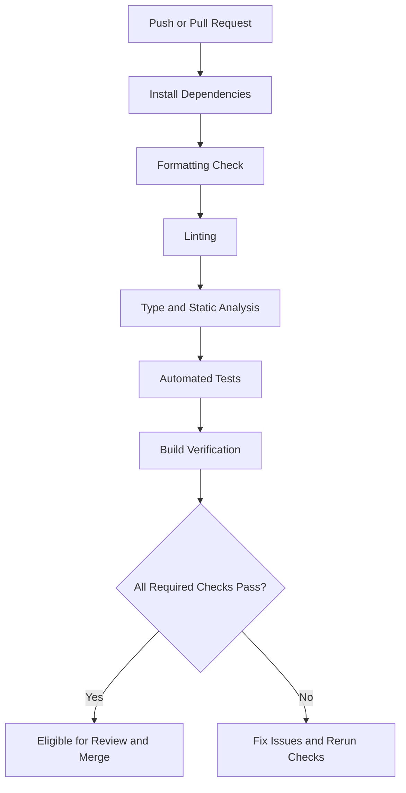
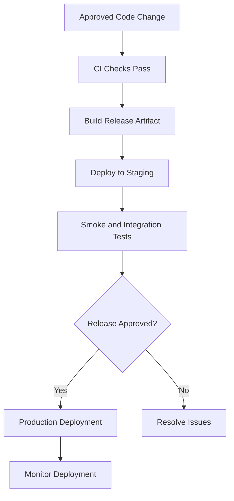

# Code Standards

This section defines the development practices used to maintain consistent, readable, secure and reliable code across Afyra's mobile application, web platform, backend and machine learning components.

The standards cover code quality, collaboration, automated verification and deployment readiness.

> **Implementation note:** The commands and tooling below describe the recommended project standards. The exact configured tools and CI/CD workflows must be verified against each repository.

## 1. Technology Overview

| Component        | Technology                 |
| ---------------- | -------------------------- |
| Mobile           | Flutter, Dart              |
| Web              | Next.js, React, TypeScript |
| Backend          | Python, FastAPI            |
| Database         | PostgreSQL                 |
| Machine Learning | Python, YOLO26n-cls        |
| Version Control  | Git                        |

Each codebase should follow the conventions and automated checks appropriate to its technology.

---

## 2. Code Formatting

Consistent formatting makes code easier to read, review and maintain.

### Frontend Web — TypeScript

Recommended formatting tool: **Prettier**.

```bash
npx prettier --check .
```

To format files:

```bash
npx prettier --write .
```

Formatting rules should be defined centrally through the repository's Prettier configuration.

### Backend — Python

Recommended formatting tool: **Ruff**.

Check formatting:

```bash
ruff format --check .
```

Apply formatting:

```bash
ruff format .
```

### Mobile — Dart

Flutter provides a built-in Dart formatter.

Check formatting:

```bash
dart format --output=none --set-exit-if-changed .
```

Apply formatting:

```bash
dart format .
```

---

## 3. Linting and Static Analysis

Linting identifies potential errors, unsafe patterns and violations of coding conventions.

### Frontend Web

Use the ESLint configuration provided by the web repository.

```bash
npx eslint .
```

Linting should cover React components, hooks, TypeScript code and application utilities.

### Backend

Recommended Python linting:

```bash
ruff check .
```

Automatically fix supported issues:

```bash
ruff check --fix .
```

### Mobile

Run Flutter's static analyzer:

```bash
flutter analyze
```

Linting rules should be maintained through the project's `analysis_options.yaml`.

---

## 4. Type Safety

### TypeScript

- Prefer explicit types for public interfaces and shared data structures.
- Avoid unnecessary use of `any`.
- Type API requests and responses.
- Handle nullable and optional values.
- Use consistent interfaces or types for application data.

Run the TypeScript compiler without emitting files:

```bash
npx tsc --noEmit
```

### Python

- Use type hints for function parameters and return values.
- Use Pydantic models for API request and response validation.
- Maintain clear interfaces between backend services.
- Validate external input before processing it.

### Dart

- Use Dart's null-safety features.
- Avoid unnecessary dynamic types.
- Handle nullable values explicitly.
- Keep models consistent with API responses.

---

## 5. Naming Conventions

| Element               | Convention                    | Example             |
| --------------------- | ----------------------------- | ------------------- |
| Python variables      | snake_case                    | `listing_status`    |
| Python functions      | snake_case                    | `calculate_price()` |
| Python classes        | PascalCase                    | `ResidueListing`    |
| TypeScript variables  | camelCase                     | `listingStatus`     |
| React components      | PascalCase                    | `ListingCard`       |
| TypeScript interfaces | PascalCase                    | `ListingResponse`   |
| Dart classes          | PascalCase                    | `FarmerProfile`     |
| Dart variables        | camelCase                     | `pickupDate`        |
| Constants             | Language-specific conventions | `MAX_IMAGE_SIZE`    |

Use meaningful names that describe the responsibility of the variable, function or component.

---

## 6. Code Organization

Code should be organized by responsibility and should avoid unnecessary duplication.

### Frontend

- Separate reusable components from page-level code.
- Keep API communication organized.
- Reuse shared types and validation rules.
- Keep components focused on a clear responsibility.
- Avoid placing unrelated business logic inside UI components.

### Backend

- Keep API route handling separate from business logic where practical.
- Centralize shared validation and configuration.
- Keep database operations organized.
- Avoid hardcoded credentials.
- Handle errors consistently.

### Machine Learning

- Separate preprocessing, inference and evaluation logic.
- Keep model configuration explicit.
- Track model artifacts and versions.
- Maintain reproducible evaluation procedures.

---

## 7. Git and Branching Standards

All changes should be tracked using Git.

### Branch Naming

Recommended branch prefixes:

| Prefix      | Purpose            | Example                     |
| ----------- | ------------------ | --------------------------- |
| `feature/`  | New functionality  | `feature/residue-listing`   |
| `fix/`      | Bug fixes          | `fix/login-validation`      |
| `docs/`     | Documentation      | `docs/api-reference`        |
| `refactor/` | Code restructuring | `refactor/pricing-service`  |
| `test/`     | Test additions     | `test/listing-validation`   |
| `chore/`    | Maintenance        | `chore/update-dependencies` |

### Commit Messages

Use descriptive commit messages.

Examples:

```text
feat: add farmer listing form
fix: handle expired authentication token
test: add pricing validation tests
docs: update API documentation
refactor: simplify listing service
```

Commit messages should communicate what changed without requiring readers to inspect every file.

---

## 8. Pull Request Standards

Code changes should be reviewed before merging into a protected branch.

### Pull Request Checklist

- [ ] The change has a clear description.
- [ ] Related requirements or issues are referenced.
- [ ] Code follows naming and formatting conventions.
- [ ] Linting passes.
- [ ] Type checking passes where applicable.
- [ ] Relevant tests pass.
- [ ] New functionality includes appropriate tests.
- [ ] No credentials or secrets are committed.
- [ ] Documentation is updated where necessary.
- [ ] UI changes include screenshots when relevant.
- [ ] Review comments are addressed.

### Review Expectations

Reviewers should evaluate correctness, maintainability, security, testing and consistency with the feature requirements.

A pull request should not be considered ready merely because it builds successfully.

---

## 9. Automated Testing

Automated tests should verify both expected behavior and relevant failure conditions.

### Frontend Web

Run the test command configured in the repository.

```bash
npm test
```

If no `test` script exists, the test framework and command must be configured before this check can run.

### Backend

A typical Python test command is:

```bash
pytest
```

Tests should cover API validation, authorization, business rules and important error conditions.

### Flutter

Run mobile tests with:

```bash
flutter test
```

Tests should cover relevant application logic, widgets and user interactions.

### Machine Learning

ML verification should include preprocessing tests, inference checks and evaluation against documented datasets.

Reported model accuracy should not substitute for integration testing.

---

## 10. Continuous Integration (CI)

Continuous Integration automatically checks changes before they are merged.

### Recommended CI Pipeline



### CI Checks by Application

| Check                   | Web                    | Backend                            | Mobile          |
| ----------------------- | ---------------------- | ---------------------------------- | --------------- |
| Dependency installation | Yes                    | Yes                                | Yes             |
| Formatting              | Prettier               | Ruff                               | Dart Format     |
| Linting                 | ESLint                 | Ruff                               | Flutter Analyze |
| Type/static analysis    | TypeScript             | Python checks                      | Dart Analyzer   |
| Automated tests         | Configured test runner | Pytest                             | Flutter Test    |
| Build verification      | Next.js build          | Application startup/package checks | Flutter build   |

The actual CI configuration must match the tools installed in each repository.

---

## 11. Build Verification

### Frontend Web

```bash
npm run build
```

This verifies that the Next.js application can produce a production build.

### Flutter

```bash
flutter build apk
```

This creates an Android APK using the configured Flutter build environment.

### Backend

Backend build verification depends on the deployment configuration.

At minimum, checks should verify dependency installation, import correctness, application startup and automated tests.

A successful build does not guarantee that external services or production workflows are functioning.

---

## 12. Continuous Deployment (CD)

Continuous Deployment or Delivery manages the release of verified application changes.

### Recommended Deployment Flow



### Deployment Requirements

Before deployment:

- Required CI checks should pass.
- Environment variables should be configured.
- Database changes should be reviewed.
- External-service credentials should be available securely.
- Relevant tests should pass.
- A rollback or recovery procedure should be available.

### Environment Separation

Recommended environments include:

| Environment | Purpose                                      |
| ----------- | -------------------------------------------- |
| Development | Local implementation and debugging           |
| Staging     | Integration testing and release verification |
| Production  | Live application deployment                  |

The actual environments and deployment triggers should be documented from Afyra's hosting configuration.

---

## 13. Security and Dependency Checks

Security checks should be part of the development workflow.

### JavaScript Dependencies

```bash
npm audit
```

### Python Dependencies

A dependency vulnerability scanner such as `pip-audit` may be used:

```bash
pip-audit
```

### Flutter Dependencies

```bash
flutter pub outdated
```

This reports dependency update availability; it is not a vulnerability scan.

### Additional Security Practices

- Never commit API keys, passwords or access tokens.
- Keep `.env` files containing secrets out of version control.
- Review third-party dependencies.
- Validate untrusted input.
- Protect production credentials.
- Apply backend authorization checks.
- Review uploaded-file handling.
- Avoid exposing sensitive information in logs.

---

## 14. Database and API Standards

### Database Changes

- Use controlled schema changes.
- Review migrations before deployment.
- Maintain appropriate constraints and relationships.
- Avoid destructive production changes without a recovery plan.
- Keep database credentials outside source code.

### API Design

- Use consistent request and response schemas.
- Apply appropriate HTTP methods and status codes.
- Validate incoming data.
- Return understandable errors.
- Enforce authentication and authorization.
- Keep API documentation aligned with implementation.

The live API specification is available through [Afyra Swagger Documentation](https://afyra-def6d466c54b.herokuapp.com/docs).

---

## 15. Documentation Standards

Code and documentation should evolve together.

Documentation updates should accompany changes affecting:

- API behavior.
- Data models.
- Authentication.
- External integrations.
- Configuration.
- User workflows.
- Deployment procedures.
- ML model behavior.

Avoid documenting planned functionality as already implemented.

---

## 16. Definition of Done

A feature is ready for completion review when:

- Its acceptance criteria are satisfied.
- Relevant code is implemented.
- Formatting and linting checks pass.
- Required tests pass.
- Integration behavior is verified.
- Security considerations are addressed.
- Documentation is updated.
- The pull request has been reviewed.
- Required CI checks are successful.

Deployment readiness is a separate decision and may require additional staging verification.

---

## References & Live Docs

- Afyra Frontend Web Repository - package scripts, ESLint and TypeScript configuration.
- Afyra Flutter Repository - Dart analysis and testing configuration.
- Afyra Backend Repository - Python tooling, tests and application configuration.
- Afyra CI/CD Workflow Files - configured automated checks and deployment jobs.
- [Afyra Swagger API Documentation](https://afyra-def6d466c54b.herokuapp.com/docs)
- [Flutter Documentation](https://docs.flutter.dev/)
- [Next.js Documentation](https://nextjs.org/docs)
- [FastAPI Documentation](https://fastapi.tiangolo.com/)
