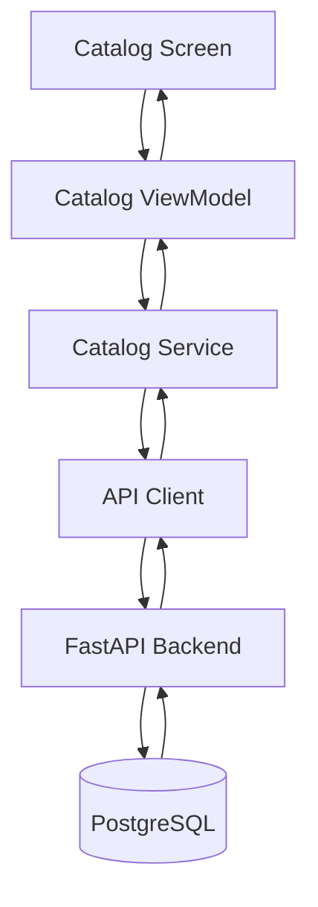
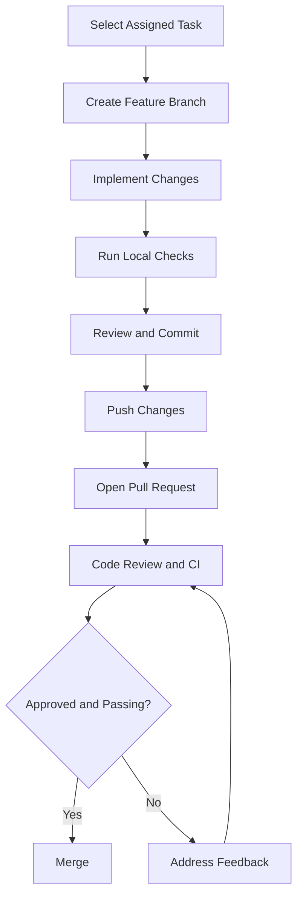

# Developer Guide

## 1. Overview

This guide explains how developers can set up the Afyra development environment, install dependencies, run the applications locally, connect to the backend, and contribute changes.

Afyra is an agricultural platform connecting farmers and manufacturers through crop-residue listings, sourcing, collection, and pricing workflows.

The platform consists of a Flutter mobile application, a Next.js web application, a FastAPI backend, a PostgreSQL database, and a machine learning component for crop-residue image classification.

## 2. Technology Stack

| Component           | Technology                 | Purpose                                   |
| ------------------- | -------------------------- | ----------------------------------------- |
| Mobile Application  | Flutter, Dart              | Farmer and driver interfaces              |
| Web Application     | Next.js, React, TypeScript | Manufacturer and administrator interfaces |
| Backend             | Python, FastAPI            | API endpoints and business logic          |
| Database            | PostgreSQL                 | Persistent application data               |
| Database Migrations | Alembic                    | Database schema management                |
| Machine Learning    | Python, YOLO26n-cls        | Crop-residue image classification         |
| Mapping             | Google Maps                | Location and mapping                      |
| Image Storage       | AWS S3                     | Uploaded image storage                    |
| Notifications       | SMS Leopard                | SMS communication                         |
| Pricing             | Tamia Feeds                | Reference pricing                         |

The frontend applications communicate with FastAPI through REST APIs. The backend manages authentication, business logic, database operations, and external integrations.

## 3. Prerequisites

Install the tools required for your assigned component.

| Tool                   | Required For        | Verification Command |
| ---------------------- | ------------------- | -------------------- |
| Git                    | Version control     | `git --version`      |
| Node.js                | Web frontend        | `node --version`     |
| npm                    | Web dependencies    | `npm --version`      |
| Flutter SDK            | Mobile development  | `flutter --version`  |
| Dart SDK               | Flutter development | `dart --version`     |
| Python                 | Backend and ML      | `python --version`   |
| PostgreSQL             | Database            | `psql --version`     |
| VS Code or another IDE | Development         | —                    |
| Postman or Swagger UI  | API testing         | —                    |

### Software Versions

Use the versions specified by each repository:

- **Flutter and Dart:** Check `pubspec.yaml`.
- **Node.js:** Check `package.json` or `.nvmrc`.
- **Python:** Check `pyproject.toml` or the backend dependency configuration.
- **PostgreSQL:** Follow the backend's database requirements.

Exact supported versions must be confirmed from the source repositories.

## 4. Repository Setup

Afyra's components are maintained in separate source-code projects.

| Repository              | Source                                                                                                      |
| ----------------------- | ----------------------------------------------------------------------------------------------------------- |
| Technical Documentation | [AkiraChix/techelle-technical-documentation](https://github.com/AkiraChix/techelle-technical-documentation) |
| Mobile Application      | Canonical repository URL to be confirmed                                                                    |
| Web Application         | Canonical repository URL to be confirmed                                                                    |
| Backend                 | Canonical repository URL to be confirmed                                                                    |

To find the remote URL of an existing local checkout:

```bash
git remote -v
```

Clone a repository using its verified URL:

```bash
git clone REPOSITORY_URL
cd PROJECT_DIRECTORY
```

Replace the example values with the actual repository URL and directory.

## 5. Web Frontend Setup

The web frontend uses Next.js, React, and TypeScript.

### Step 1: Open the Project

```bash
cd WEB_PROJECT_DIRECTORY
```

### Step 2: Install Dependencies

If the repository uses npm with a compatible `package-lock.json`:

```bash
npm ci
```

Otherwise, use the package manager specified by the repository.

### Step 3: Configure Environment Variables

Check for an environment template:

```bash
ls -a
```

Configure the backend API URL and other required values using the exact variable names defined by the web project.

Do not commit credentials or expose private secrets in public frontend variables.

### Step 4: Run the Development Server

```bash
npm run dev
```

Open the local URL displayed in the terminal.

### Step 5: Verify the Build

```bash
npm run build
```

A successful build confirms that the application compiles. It does not guarantee that all features have passed functional testing.

See [Frontend Web](/frontend-web/) for implementation details.

## 6. Mobile Frontend Setup

The Afyra mobile application uses Flutter, Dart, and an MVVM architecture.

### Step 1: Open the Flutter Project

Navigate to the directory containing `pubspec.yaml`.

```bash
cd afyra
```

### Step 2: Check the Flutter Environment

```bash
flutter doctor
flutter devices
```

Resolve missing SDK or device requirements.

### Step 3: Install Dependencies

```bash
flutter pub get
```

### Step 4: Configure API Connectivity

Locate the existing API client's base URL configuration.

Set it to an accessible address for the running FastAPI backend.

When using a physical phone, `localhost` refers to the phone rather than the development computer.

For Flutter Web, verify that backend CORS settings permit requests from the frontend origin.

### Step 5: Run the Application

```bash
flutter run
```

To select a specific device:

```bash
flutter run -d DEVICE_ID
```

To run in Chrome when available:

```bash
flutter run -d chrome
```

### Step 6: Run Quality Checks

```bash
dart format --output=none --set-exit-if-changed lib
flutter analyze
flutter test
```

Record the actual test results rather than assuming that the tests passed.

### Mobile Application Architecture

| Layer             | Responsibility                          |
| ----------------- | --------------------------------------- |
| Screens           | Display data and collect input          |
| ViewModels        | Manage application state                |
| Services          | Communicate with backend APIs           |
| Models            | Represent application data              |
| Shared Components | Reusable interface elements             |
| API Client        | Handle HTTP requests and authentication |

Example catalog data flow:



Developers should use existing services and ViewModels rather than calling APIs directly from screens.

See [Frontend Mobile](/frontend-mobile/).

## 7. Backend Setup

The backend uses Python and FastAPI.

### Step 1: Open the Backend Repository

```bash
cd BACKEND_PROJECT_DIRECTORY
```

### Step 2: Create a Virtual Environment

```bash
python3 -m venv .venv
source .venv/bin/activate
```

Verify Python:

```bash
python --version
```

### Step 3: Install Dependencies

Check the repository's dependency configuration:

```bash
ls pyproject.toml requirements.txt uv.lock poetry.lock 2>/dev/null
```

If `requirements.txt` is the supported installation method:

```bash
python -m pip install -r requirements.txt
```

Otherwise, use the dependency manager configured by the backend.

### Step 4: Configure Environment Variables

The backend requires configuration for database access, authentication, and enabled integrations.

| Configuration                | Purpose                         |
| ---------------------------- | ------------------------------- |
| Database connection          | PostgreSQL connectivity         |
| Authentication settings      | User login and token validation |
| CORS settings                | Browser API access              |
| AWS S3 settings              | Image storage                   |
| SMS Leopard settings         | SMS communication               |
| Pricing integration settings | Supplier price references       |
| ML model configuration       | Classification model loading    |

Use the exact variable names defined by the backend settings code.

Never commit `.env` files containing real secrets.

### Step 5: Start FastAPI

Find the application entry point:

```bash
grep -R "FastAPI(" -n afyra --include='*.py'
```

Start Uvicorn with the verified module and application object:

```bash
uvicorn MODULE:APP_OBJECT --reload
```

For example, if `afyra/main.py` defines `app`:

```bash
uvicorn afyra.main:app --reload
```

Confirm the import path before using this example.

### Step 6: Open API Documentation

For a backend running locally on port 8000:

```text
http://127.0.0.1:8000/docs
```

Hosted API documentation:

[Afyra Swagger Documentation](https://afyra-def6d466c54b.herokuapp.com/docs)

For endpoint contracts, see [API Documentation](/backend/api-documentation).

## 8. Database Setup

Afyra uses PostgreSQL for persistent storage and Alembic for migrations.

### Step 1: Start PostgreSQL

Start the PostgreSQL service using the appropriate command for your operating system.

### Step 2: Configure the Database

Create or obtain the approved development database.

Configure the backend's database connection using its documented settings.

### Step 3: Apply Migrations

From the backend repository root:

```bash
alembic upgrade head
```

This applies the database migrations.

Do not manually create tables already managed through Alembic.

### Step 4: Verify Connectivity

Start FastAPI and test a database-backed endpoint through Swagger.

For example:

```http
GET /residue-types
```

An empty response (`[]`) indicates that no residue types were returned. It does not necessarily mean the database connection failed.

The database stores user accounts, farms, residue listings, residue types, market prices, sourcing requests, and related records.

See [ERD & Data Models](/architecture/data-models).

## 9. Machine Learning Setup

Afyra includes a crop-residue image classification component.

The existing documentation identifies YOLO26n-cls and the model artifact:

```text
ml/weights/residue_cls.pt
```

Before working on classification:

1. Verify the model weights are available.
2. Install the required ML dependencies.
3. Confirm supported image formats and preprocessing.
4. Run the project's inference workflow.
5. Verify invalid-image handling.
6. Check low-confidence and failed-classification behavior.
7. Record actual evaluation results.

Do not claim model accuracy without supporting evaluation evidence.

See [AI](/ai/).

## 10. Working with APIs

The mobile and web frontends communicate with FastAPI through REST endpoints.

Before integrating an endpoint:

1. Confirm its route and HTTP method.
2. Review the request and response schemas.
3. Check authentication requirements.
4. Configure the frontend API base URL.
5. Use the project's existing API client.
6. Handle loading, empty, success, and error states.
7. Test the complete workflow.

### Example: Residue Catalog

```http
GET /residue-types
```

Illustrative successful response:

```json
[
  {
    "residue_type_id": 1,
    "name": "Maize stalks"
  }
]
```

The record above illustrates the API schema and does not represent verified production data.

An empty catalog returns:

```json
[]
```

### Price Quotation

```http
GET /prices/quote
```

Required parameters:

- `residue_type_id`: Integer
- `county`: String

Authentication is required.

The response includes the available rate, effective date, stale-price indicator, and price source. The rate may be `null` when no price is available.

### Price Estimation

```http
GET /prices/estimate
```

Required parameters:

- `residue_type_id`
- `county`
- `weight_kg`

Optional parameter:

- `grade`: `GOOD` or `POOR`

The response contains an estimated price range and estimated totals.

For complete request and response examples, authentication requirements, and error codes, see [API Documentation](/backend/api-documentation).

## 11. External Integrations

| Integration | Purpose           | Verification                                      |
| ----------- | ----------------- | ------------------------------------------------- |
| Tamia Feeds | Reference pricing | Confirm source availability and stored price data |
| Google Maps | Mapping           | Confirm API configuration and supported features  |
| AWS S3      | Image storage     | Verify storage configuration and permissions      |
| SMS Leopard | SMS communication | Verify credentials and delivery behavior          |
| YOLO26n-cls | Classification    | Verify weights and inference execution            |

An integration being present in the codebase does not automatically mean it is operational in every environment.

See [Integrations](/integrations/).

## 12. Development Workflow



### Create a Feature Branch

```bash
git checkout -b feature/short-description
```

### Review Changes

```bash
git status
git diff
git diff --check
```

### Stage and Commit

```bash
git add path/to/changed-file
git commit -m "feat: describe the change"
```

### Push

```bash
git push -u origin "$(git branch --show-current)"
```

Open a pull request describing the changes, tests performed, and any remaining limitations.

## 13. Local Quality Checks

| Component        | Checks                             |
| ---------------- | ---------------------------------- |
| Flutter          | Formatting, static analysis, tests |
| Next.js          | TypeScript, linting, tests, build  |
| FastAPI          | Python formatting, linting, tests  |
| Machine Learning | Inference tests and evaluation     |
| Database         | Migrations and database tests      |

Example Flutter checks:

```bash
flutter analyze
flutter test
```

Example Next.js build:

```bash
npm run build
```

Example backend tests, where pytest is configured:

```bash
pytest
```

Running a command does not mean the tests passed. Record the actual results in [Testing and QA](/qa/).

## 14. Troubleshooting

| Problem                       | Possible Cause                    | Recommended Action                  |
| ----------------------------- | --------------------------------- | ----------------------------------- |
| Frontend cannot reach backend | Incorrect API URL                 | Verify the URL and backend status   |
| Browser request blocked       | CORS settings                     | Check allowed origins               |
| HTTP 401                      | Missing or expired authentication | Reauthenticate                      |
| HTTP 403                      | Insufficient permissions          | Check user role                     |
| HTTP 422                      | Invalid request fields            | Compare payload with API schema     |
| Empty catalog                 | No residue types returned         | Verify backend catalog records      |
| No price available            | Missing price data                | Show unavailable-price state        |
| Database connection fails     | Database settings                 | Check PostgreSQL and connection URL |
| Flutter fails to launch       | SDK or device issue               | Run `flutter doctor`                |
| Classification fails          | Missing weights or invalid image  | Check model and validation          |
| SMS delivery fails            | Provider or configuration issue   | Check provider response and logs    |
| CI fails                      | Code or configuration problem     | Review CI logs                      |

## 15. Pull Request Checklist

Before submitting a pull request, make sure:

- Assigned task is complete.
- Changes follow the existing architecture.
- Relevant tests were executed.
- Test results were recorded accurately.
- Formatting and analysis checks were performed.
- API requests match backend schemas.
- Authentication and permissions are respected.
- No secrets or private environment files are committed.
- UI changes include screenshots where appropriate.
- Documentation is updated.
- Known limitations are described.

## 16. Related Documentation

- [System Architecture](/architecture/sad)
- [ERD & Data Models](/architecture/data-models)
- [Frontend Mobile](/frontend-mobile/)
- [Frontend Web](/frontend-web/)
- [Backend](/backend/)
- [API Documentation](/backend/api-documentation)
- [AI](/ai/)
- [Integrations](/integrations/)
- [Security](/security/)
- [Testing and QA](/qa/)
- [Code Standards](/code-standards/)

