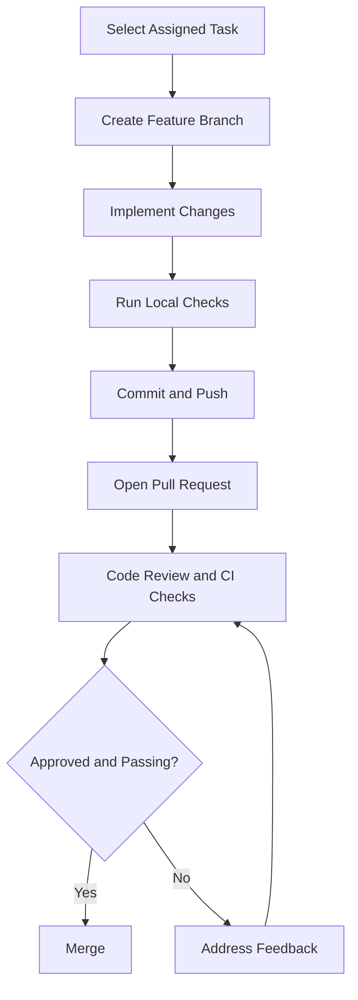

# Developer Guide

Welcome to the Afyra Developer Guide.

This guide introduces the development environment, project structure, local setup and contribution workflow for developers working on Afyra.

## 1. Getting Started

Afyra consists of several connected applications and services.

| Component        | Technology                                    | Responsibility                                      |
| ---------------- | --------------------------------------------- | --------------------------------------------------- |
| Frontend Mobile  | Flutter, Dart                                 | Farmer and driver application                       |
| Frontend Web     | Next.js, React, TypeScript                    | Manufacturer and administrator interfaces           |
| Backend          | Python, FastAPI                               | APIs and business logic                             |
| Database         | PostgreSQL                                    | Persistent application data                         |
| Machine Learning | Python, YOLO26n-cls                           | Crop-residue quality classification                 |
| Integrations     | Google Maps, AWS S3, SMS Leopard, Tamia Feeds | Supporting platform services and pricing references |

Developers should understand how their assigned component communicates with the rest of the platform.

## 2. Prerequisites

Install the tools relevant to the component you are developing.

| Tool                   | Required For        |
| ---------------------- | ------------------- |
| Git                    | Version control     |
| Node.js and npm        | Web frontend        |
| Flutter SDK            | Mobile frontend     |
| Dart SDK               | Flutter development |
| Python                 | Backend and ML      |
| PostgreSQL             | Database            |
| VS Code or another IDE | Development         |
| Postman or Swagger     | API testing         |

Use the versions specified in each repository's configuration.

## 3. Clone the Repository

Clone the relevant Afyra repository using its actual Git URL.

```bash
git clone <repository-url>
cd <repository-folder>
```

The mobile, web and backend projects may have separate repositories.

Refer to the team's repository links for the correct source locations.

## 4. Frontend Web Setup

Navigate to the web frontend project.

### Install Dependencies

```bash
npm install
```

### Configure Environment Variables

Create the environment file required by the repository.

Use the supplied example environment file when available.

Do not commit credentials or private configuration.

### Start the Development Server

```bash
npm run dev
```

Open the local address printed by Next.js.

### Production Build

```bash
npm run build
```

For application details, see [Frontend Web](/frontend-web/).

---

## 5. Frontend Mobile Setup

Navigate to the Flutter application.

### Install Dependencies

```bash
flutter pub get
```

### Check the Development Environment

```bash
flutter doctor
```

Resolve any missing SDK or device requirements.

### Run the Application

```bash
flutter run
```

Select an available emulator or connected device.

### Run Static Analysis

```bash
flutter analyze
```

### Run Tests

```bash
flutter test
```

For mobile workflows and screens, see [Frontend Mobile](/frontend-mobile/).

---

## 6. Backend Setup

Navigate to the FastAPI backend repository.

### Create a Virtual Environment

```bash
python -m venv .venv
```

Activate it on Linux or macOS:

```bash
source .venv/bin/activate
```

### Install Dependencies

Use the dependency manager and lockfile provided by the backend repository.

For a repository using `requirements.txt`:

```bash
pip install -r requirements.txt
```

If the repository uses `pyproject.toml`, follow its configured installation instructions instead.

### Configure Environment Variables

Set the database connection, authentication settings and required integration credentials using the backend's documented configuration.

Never commit real credentials.

### Start the Backend

For a FastAPI application exposed as `app` in `main.py`, the typical command is:

```bash
uvicorn main:app --reload
```

Adjust the import path to match the actual backend entry point.

### API Documentation

Once the backend is running, open its local `/docs` endpoint.

The hosted Afyra API documentation is available at:

[Open Afyra Swagger Documentation](https://afyra-def6d466c54b.herokuapp.com/docs)

---

## 7. Database Setup

Afyra uses PostgreSQL to manage structured application data.

Before running database-dependent features:

1. Install and start PostgreSQL.
2. Create or configure the required development database.
3. Set the database connection environment variable.
4. Apply the migrations provided by the backend repository.
5. Confirm the backend can connect successfully.

Do not create database tables manually if the repository provides a migration workflow.

For the database structure, see [ERD & Data Models](/architecture/data-models).

---

## 8. Machine Learning Setup

Afyra's crop-residue quality classifier is integrated with the backend.

The documented model artifact is:

```text
ml/weights/residue_cls.pt
```

Developers working on ML functionality should verify:

- Model artifact availability.
- Required Python dependencies.
- Image preprocessing configuration.
- Inference execution.
- Confidence handling.
- Backend integration.

Do not retrain or replace the model without an approved evaluation process.

For model details, see [AI](/ai/).

---

## 9. Working with APIs

The mobile and web applications communicate with the FastAPI backend.

### Development Workflow

1. Identify the relevant backend endpoint.
2. Review its request and response schemas in Swagger.
3. Configure the frontend API base URL.
4. Implement the request using the project's existing API client.
5. Handle loading, success and error states.
6. Test the complete interaction.

### API Guidelines

- Do not invent endpoint paths.
- Use the backend's actual request schemas.
- Handle authentication correctly.
- Validate user input.
- Avoid hardcoded production URLs.
- Do not expose private tokens in logs.

---

## 10. External Integrations

Afyra uses supporting services for pricing references, maps, image storage, classification and notifications.

| Integration | Developer Responsibility                  |
| ----------- | ----------------------------------------- |
| Tamia Feeds | Maintain approved pricing-reference data  |
| Google Maps | Configure supported mapping functionality |
| AWS S3      | Configure secure image storage            |
| YOLO26n-cls | Maintain image-classification integration |
| SMS Leopard | Configure supported SMS workflows         |

Refer to [Integrations](/integrations/) for more information.

---

## 11. Development Workflow

The recommended contribution process is:



### Create a Branch

```bash
git checkout -b feature/your-feature-name
```

### Review Changes

```bash
git status
git diff
```

### Commit Changes

```bash
git add .
git commit -m "feat: describe your change"
```

### Push Changes

```bash
git push -u origin feature/your-feature-name
```

Open a pull request using the team's established workflow.

---

## 12. Local Quality Checks

Run the checks appropriate to your application before submitting changes.

| Component | Checks                                      |
| --------- | ------------------------------------------- |
| Web       | ESLint, TypeScript, tests and build         |
| Backend   | Python linting, formatting and tests        |
| Mobile    | Dart formatting, Flutter analysis and tests |
| ML        | Inference checks and model evaluation       |

The exact commands depend on the scripts and tooling configured in each repository.

See [Code Standards](/code-standards/) for detailed guidance.

---

## 13. Pull Request Checklist

Before requesting review:

- [ ] The assigned feature or fix is complete.
- [ ] The code follows project conventions.
- [ ] Relevant tests pass.
- [ ] Linting and formatting checks pass.
- [ ] API integration has been verified.
- [ ] No secrets or credentials are committed.
- [ ] UI changes include screenshots where appropriate.
- [ ] Documentation is updated.
- [ ] The pull request clearly describes the changes.

---

## 14. Troubleshooting

| Problem                            | What to Check                                         |
| ---------------------------------- | ----------------------------------------------------- |
| Frontend cannot connect to backend | API base URL, server status and network configuration |
| Backend fails to start             | Dependencies, environment variables and entry point   |
| Database connection fails          | PostgreSQL status, credentials and database URL       |
| Flutter app does not launch        | `flutter doctor`, emulator and device setup           |
| Image classification fails         | Model artifact, dependencies and input validation     |
| SMS notifications fail             | Provider configuration, credentials and error logs    |
| CI checks fail                     | Workflow logs, formatting, linting and tests          |

Use application logs and error messages to identify the specific failure before changing configuration.

---

## 15. Related Documentation

- [System Architecture Diagram](/architecture/sad)
- [Frontend Mobile](/frontend-mobile/)
- [Frontend Web](/frontend-web/)
- [Backend](/backend/)
- [AI](/ai/)
- [Integrations](/integrations/)
- [Code Standards](/code-standards/)
- [Security](/security/)
- [QA](/qa/)

## References & Live Docs

- Afyra Mobile Repository - Flutter source code and setup instructions.
- Afyra Web Repository - Next.js source code and package scripts.
- Afyra Backend Repository - API source code and environment configuration.
- Afyra CI/CD Workflows - automated verification and deployment configuration.
- [Afyra Swagger API Documentation](https://afyra-def6d466c54b.herokuapp.com/docs)
