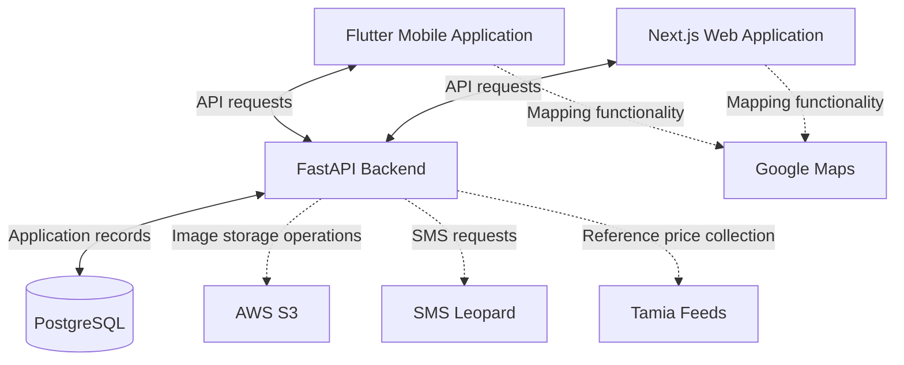
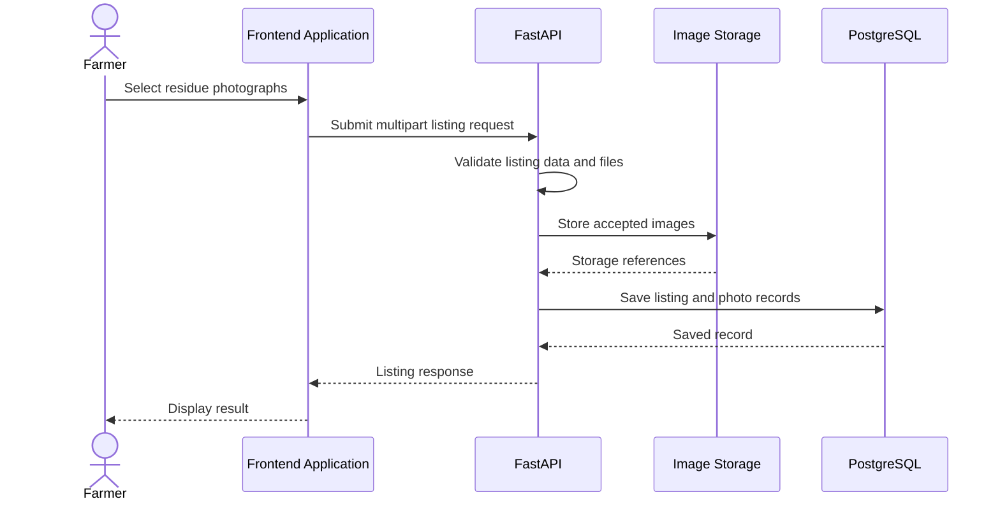
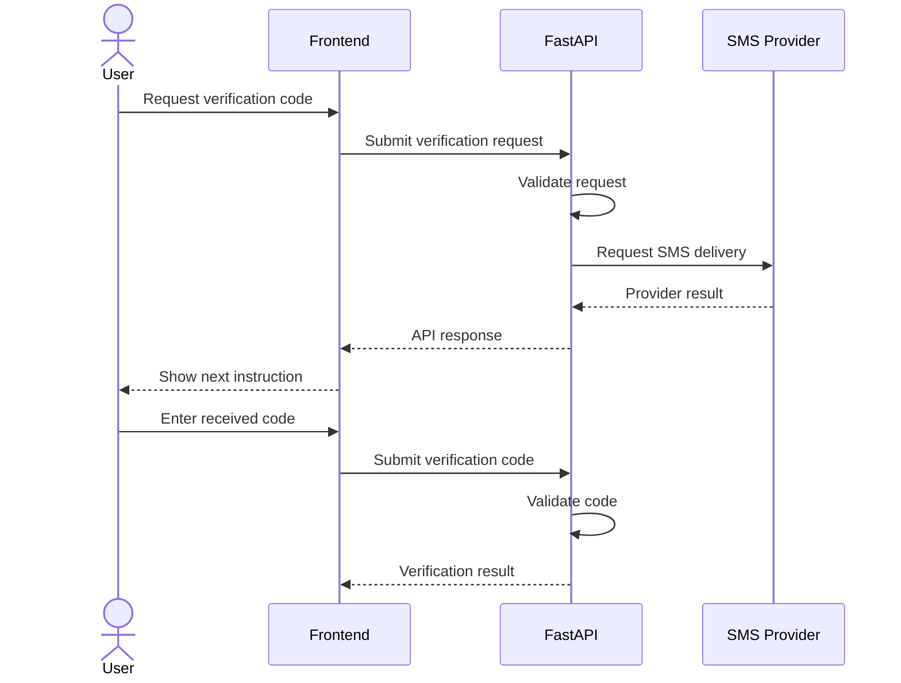
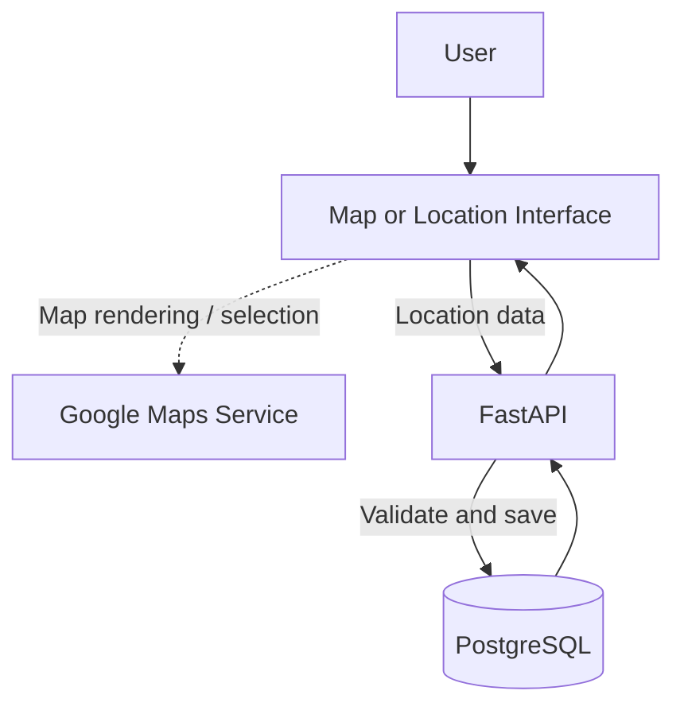
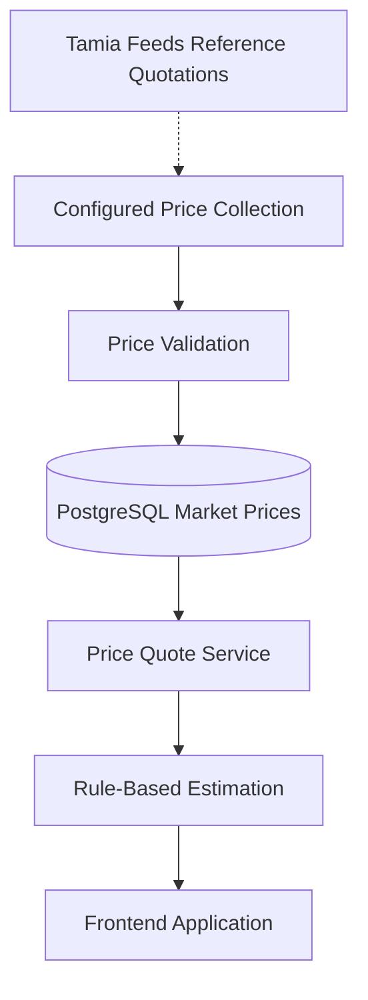
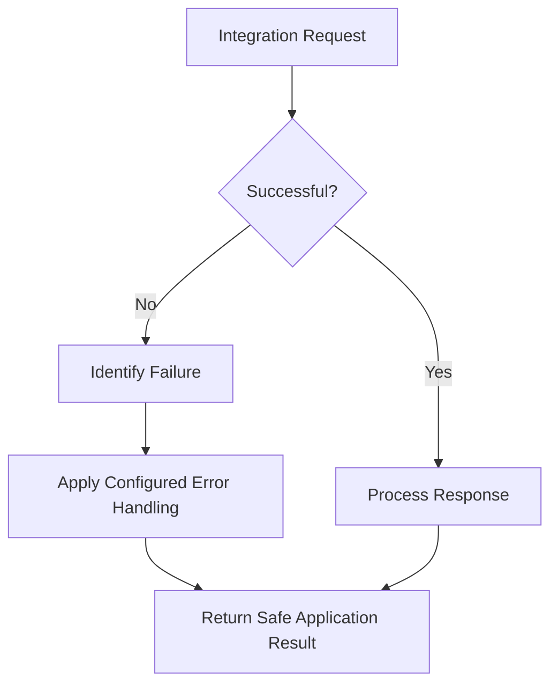

# External Integrations

## 1. Overview

Afyra connects with external services to support operations that are not handled entirely by its own backend and database.

These integrations support image storage, SMS communication, mapping, and crop-residue reference pricing.

The main external services identified for Afyra are:

- **AWS S3:** Storage for uploaded crop-residue images.
- **SMS Leopard:** Phone-based messages and verification workflows.
- **Google Maps:** Location and mapping functionality.
- **Tamia Feeds:** Reference pricing information used in crop-residue price estimation.

Afyra uses FastAPI for backend operations, PostgreSQL for structured records, Flutter for its mobile application, and Next.js for its web application.

This document describes each integration's purpose, expected data flow, configuration requirements, and failure handling.

It also identifies details that must be confirmed from the actual source code and deployment environment.

## 2. Integration Overview

| Integration | Purpose                                   | Related Functionality                                       | Implementation Evidence                                                               |
| ----------- | ----------------------------------------- | ----------------------------------------------------------- | ------------------------------------------------------------------------------------- |
| AWS S3      | Store uploaded images                     | Residue listings and photographs                            | Identified in project architecture; storage implementation requires verification      |
| SMS Leopard | Send SMS messages                         | Account verification, activation, and related communication | Provider identified; exact backend adapter requires verification                      |
| Google Maps | Display and use geographic information    | Farm locations, sourcing, and delivery coordination         | Mapping integration identified; client configuration requires verification            |
| Tamia Feeds | Provide crop-residue reference quotations | Market prices and price estimation                          | Pricing endpoints confirmed; supplier collection implementation requires verification |

**Important:** An API endpoint existing in the backend does not automatically prove that an external provider is configured and operational in production.

## 3. Integration Architecture



The diagram shows the intended integration boundaries.

Dotted connections represent external integrations whose exact implementation path or operational status must be verified.

The diagram does not imply that every service is contacted during every user request.

## 4. AWS S3 Integration

### 4.1 Purpose

AWS Simple Storage Service (S3) provides object storage for files.

In Afyra, it is identified as the storage service for uploaded crop-residue images.

Keeping image files separate from structured PostgreSQL records allows the application to manage file storage and database information independently.

### 4.2 Related User Workflow

When a farmer creates a residue listing, the backend accepts three photographs.

| Field         | Description                                  |
| ------------- | -------------------------------------------- |
| `photo_macro` | Close-up photograph                          |
| `photo_core`  | Photograph of the inside of the pile or bale |
| `photo_base`  | Photograph of the bottom of the pile         |

The listing API uses:

```http
POST /residue_listings
Content-Type: multipart/form-data
```

Other required listing fields include:

```text
farm_id
residue_type_id
weight_kg
available_from
available_until
```

The OpenAPI contract also documents a required `user-id` header for this operation. Developers must check the current listing endpoint's authentication requirements rather than assuming they are identical to every bearer-protected route.

### 4.3 Image Storage Flow



This is a logical flow, not a verified execution trace. The exact order of image validation, AI inference, storage, and database writes must be confirmed in the backend implementation.

### 4.4 Configuration

An S3 integration typically requires:

| Configuration               | Purpose                        |
| --------------------------- | ------------------------------ |
| AWS region                  | Region containing the bucket   |
| Bucket name                 | Destination for stored images  |
| AWS credentials or IAM role | Permission to access storage   |
| Object key structure        | Identifies stored files        |
| Access policy               | Controls who can access images |

The actual environment variable names must come from Afyra's storage configuration.

Do not introduce guessed variables into the project's `.env` file.

### 4.5 Error Handling

The application should account for:

- Missing images.
- Unsupported file types.
- Corrupted files.
- Storage connection failures.
- Missing storage permissions.
- Failed uploads.
- Unavailable image references.

A failed upload should not be presented to the user as a successful listing submission.

If a workflow stores files before saving the database record, the implementation should also address partially completed operations.

### 4.6 Verification Checklist

- Confirm the configured S3 bucket.
- Confirm the backend storage client.
- Confirm the accepted image formats.
- Confirm maximum upload size.
- Verify successful image upload.
- Verify image references saved with listings.
- Verify unauthorized image access is restricted.
- Test storage failure handling.
- Confirm how orphaned files are handled.

## 5. SMS Leopard Integration

### 5.1 Purpose

SMS Leopard is identified as Afyra's SMS provider.

SMS communication supports phone-based account workflows.

The backend API includes operations for verification, activation, and account recovery.

### 5.2 Related API Operations

Representative endpoints include:

```http
POST /auth/resend-code
POST /auth/verify-phone
POST /auth/activate
POST /auth/forgot-password
POST /auth/reset-password
```

The backend also includes an operation for resending a driver's activation code:

```http
POST /drivers/{driver_id}/resend-code
```

These endpoints confirm that Afyra supports code-based account workflows.

The OpenAPI specification alone does not prove which endpoints call SMS Leopard directly.

### 5.3 SMS Communication Flow



The exact message-generation, delivery, and code-validation steps must be verified against the authentication service.

### 5.4 Configuration

The SMS integration may require:

- Provider API credentials.
- Sender configuration.
- Supported phone-number format.
- Message templates.
- Request timeout configuration.
- Provider response handling.

The actual environment variables and message templates should be documented from the backend implementation.

### 5.5 Failure Handling

Possible failures include:

- Invalid phone numbers.
- Provider unavailability.
- SMS delivery rejection.
- Incorrect verification codes.
- Expired verification codes.
- Excessive resend attempts.

The frontend should distinguish between a failed request and a successfully submitted request.

It should not claim that a message was delivered unless the provider or backend confirms that state.

### 5.6 Verification Checklist

- Confirm the SMS Leopard client or adapter.
- Verify provider credentials are configured securely.
- Confirm supported phone-number formats.
- Test verification-code delivery.
- Test incorrect verification codes.
- Test expired codes.
- Test resend behavior.
- Confirm rate-limiting behavior.
- Verify provider failure handling.

## 6. Google Maps Integration

### 6.1 Purpose

Google Maps supports geographic functionality in Afyra.

Location information is important because farmers, manufacturers, and drivers operate across different areas.

The platform uses geographic information for:

- Farm registration.
- Farm location display.
- Manufacturer delivery locations.
- Sourcing-distance information.
- Pickup and driver coordination.

The exact mapping features implemented in Flutter and Next.js must be confirmed from the frontend source.

### 6.2 Location Data in the Backend

The farm registration API accepts:

```json
{
  "farm_name": "Example Farm",
  "county": "Nakuru",
  "latitude": "-0.3031",
  "longitude": "36.0800",
  "can_host": false
}
```

This is illustrative test data.

The backend also supports driver-location updates through:

```http
PUT /drivers/me/location
```

The request includes numeric latitude and longitude.

These endpoints confirm that the backend supports geographic data. They do not, by themselves, confirm that every location is displayed through Google Maps.

### 6.3 Mapping Data Flow



The map-rendering connection is conceptual and must be checked against the actual mobile and web integrations.

### 6.4 Configuration

Depending on the application and Google Maps SDK used, configuration may include:

- API key.
- Enabled Google Maps APIs.
- Application or domain restrictions.
- Android package restrictions.
- iOS application restrictions.
- Web domain restrictions.
- Billing configuration.

Only the configuration relevant to the actual Afyra implementation should be documented.

### 6.5 Location Security

Location information may reveal where farmers live, work, or store agricultural materials.

The application should:

- Request location permissions where required.
- Validate coordinates.
- Limit access to sensitive location records.
- Avoid unnecessary location logging.
- Restrict mapping API keys.
- Explain location-related failures clearly.

### 6.6 Failure Handling

Possible issues include:

- Location permission denied.
- GPS unavailable.
- Invalid coordinates.
- Map service unavailable.
- API key restrictions.
- Network connection failure.

The application should preserve valid form information when a map service is unavailable, where the workflow supports doing so.

### 6.7 Verification Checklist

- Confirm the Maps SDK used by Flutter.
- Confirm whether Next.js uses Google Maps.
- Verify map API key restrictions.
- Test location permission handling.
- Test valid coordinate selection.
- Test invalid coordinates.
- Test map loading failure.
- Confirm how location data reaches the backend.

## 7. Tamia Feeds Pricing Integration

### 7.1 Purpose

Tamia Feeds is Afyra's identified reference source for crop-residue pricing.

Afyra uses reference quotations and rule-based calculations to estimate the value of agricultural residues.

The pricing feature is not described as a machine learning price-prediction model.

### 7.2 Pricing API Operations

The backend exposes:

```http
GET /prices/quote
GET /prices/estimate
```

Administrative operations include:

```http
GET /admin/market-prices
POST /admin/market-prices
POST /admin/market-prices/collect
```

These endpoints support retrieving quotations, calculating estimates, managing stored market prices, and triggering the configured price-collection workflow.

### 7.3 Reference Price Flow



This diagram represents the intended reference-price workflow.

The supplier collection mechanism, whether manual, scraped, or API-based, must be confirmed from the actual integration code.

### 7.4 Price Quote

**Endpoint:**

```http
GET /prices/quote
```

Required parameters:

| Parameter         | Type    | Description                   |
| ----------------- | ------- | ----------------------------- |
| `residue_type_id` | Integer | Residue type                  |
| `county`          | String  | County used for the quotation |

The response contains:

- `residue_type_id`
- `county`
- `rate_kes_per_kg`
- `effective_date`
- `is_stale`
- `source`

The rate and effective date can be null when a quotation is unavailable.

A price is considered stale when it is older than 90 days.

### 7.5 Price Estimate

**Endpoint:**

```http
GET /prices/estimate
```

Required parameters:

| Parameter         | Type            | Description           |
| ----------------- | --------------- | --------------------- |
| `residue_type_id` | Integer         | Residue type          |
| `county`          | String          | County                |
| `weight_kg`       | Positive number | Quantity in kilograms |

Optional parameter:

| Parameter | Allowed Values | Default |
| --------- | -------------- | ------- |
| `grade`   | `GOOD`, `POOR` | `GOOD`  |

Afyra's quality model has only two categories:

- `good`
- `bad`

The pricing service returns an estimated range rather than a guaranteed selling price.

### 7.6 Pricing Calculation

The estimate is based on reference pricing and adjustment rules.

The response includes:

- Minimum estimated price per kilogram.
- Maximum estimated price per kilogram.
- Minimum estimated total.
- Maximum estimated total.
- Quality category.
- Weight.
- Adjustment points.
- Reference source.
- Calculation method.
- Estimate indicator.

The exact calculation formula and adjustment values must be documented from the pricing service.

No supplier quotations or numeric adjustment rules should be invented.

### 7.7 Pricing Failure Handling

Possible problems include:

- No available quotation.
- Missing residue mapping.
- Unsupported county.
- Invalid quantity.
- Unsupported quality grade.
- Stale pricing information.
- Supplier source unavailable.
- Price-collection failure.

The frontend should not replace unavailable supplier prices with fabricated values.

If a price is stale, the user interface should communicate that limitation.

### 7.8 Verification Checklist

- Confirm the current Tamia Feeds collection implementation.
- Confirm supported residue mappings.
- Confirm supported counties.
- Verify the source of stored reference prices.
- Verify price freshness rules.
- Verify good-quality estimation.
- Verify bad-quality estimation.
- Verify quantity adjustments.
- Test unavailable quotation behavior.
- Test supplier collection failures.
- Verify administrative access to price collection.

## 8. Integration Configuration

External integrations require environment-specific configuration.

### Configuration Principles

1. Store secrets outside source code.
2. Use the existing backend and frontend configuration conventions.
3. Restrict credentials to the required permissions.
4. Avoid placing server credentials in public frontend variables.
5. Use separate development and production configuration where applicable.
6. Document required configuration without publishing secret values.

### Configuration Inventory

| Integration | Configuration to Verify                             | Source of Truth               |
| ----------- | --------------------------------------------------- | ----------------------------- |
| AWS S3      | Bucket, region, credentials, access permissions     | Backend storage configuration |
| SMS Leopard | API credentials, sender, message configuration      | Backend SMS service           |
| Google Maps | SDK configuration and API-key restrictions          | Flutter and Next.js source    |
| Tamia Feeds | Supplier source, mappings, collection configuration | Backend pricing integration   |

The exact environment variable names must be copied from the actual source code or environment template.

Do not create new variable names solely for documentation.

## 9. Integration Error Handling

External services can fail independently of Afyra.

The backend and frontend should handle these failures without incorrectly reporting success.

### Common Failure Categories

| Failure                | Example                               | Expected Handling                           |
| ---------------------- | ------------------------------------- | ------------------------------------------- |
| Network failure        | Service cannot be reached             | Return or display an appropriate error      |
| Authentication failure | Invalid provider credentials          | Record the failure without exposing secrets |
| Invalid input          | Unsupported file or malformed request | Reject the request                          |
| Timeout                | Provider does not respond in time     | Apply the configured timeout behavior       |
| Unavailable data       | No supplier price exists              | Show an unavailable state                   |
| Rate limiting          | Provider rejects excessive requests   | Respect provider limits                     |
| Partial completion     | Image stored but listing not saved    | Handle incomplete operations safely         |

The exact retry and recovery behavior must be verified from the implementation.

### Integration Error Flow



## 10. Integration Testing

Each external integration should be tested separately and as part of the complete user workflow.

| Test ID | Integration | Test Scenario                                             | Expected Result                        | Status       |
| ------- | ----------- | --------------------------------------------------------- | -------------------------------------- | ------------ |
| INT-01  | AWS S3      | Upload valid residue image                                | File stored and reference returned     | Not recorded |
| INT-02  | AWS S3      | Upload unsupported file                                   | File rejected safely                   | Not recorded |
| INT-03  | AWS S3      | Storage unavailable                                       | Failure handled without false success  | Not recorded |
| INT-04  | SMS Leopard | Request valid verification code                           | SMS workflow processes request         | Not recorded |
| INT-05  | SMS Leopard | Provider unavailable                                      | Appropriate error handling             | Not recorded |
| INT-06  | Google Maps | Display valid location                                    | Map displays expected location         | Not recorded |
| INT-07  | Google Maps | Deny location permission                                  | Application handles denial             | Not recorded |
| INT-08  | Tamia Feeds | Retrieve available reference quotation                    | Correct reference information returned | Not recorded |
| INT-09  | Tamia Feeds | No quotation available                                    | No fabricated price returned           | Not recorded |
| INT-10  | Pricing     | Calculate estimate using good quality                     | Valid estimate response                | Not recorded |
| INT-11  | Pricing     | Calculate estimate using bad quality                      | Valid estimate response                | Not recorded |
| INT-12  | Pricing     | Trigger supplier collection with insufficient permissions | Access denied                          | Not recorded |

These are defined test cases, not evidence that the integrations have passed testing.

## 11. Integration Monitoring

Useful monitoring information includes:

- Number of integration requests.
- Successful and failed requests.
- Provider response times.
- Authentication failures.
- Timeouts.
- Upload failures.
- SMS delivery failures.
- Pricing collection failures.
- Missing or stale reference prices.

Logs should contain enough information to investigate failures without exposing credentials or unnecessary personal data.

Actual monitoring tools and alerting configuration must be confirmed from the deployment environment.

## 12. Implementation Status and Open Items

The following table separates confirmed API capabilities from details that require source-code or deployment verification.

| Integration | Confirmed Information                                                                                            | Remaining Verification                                                         |
| ----------- | ---------------------------------------------------------------------------------------------------------------- | ------------------------------------------------------------------------------ |
| AWS S3      | Crop-residue listing API accepts image uploads; S3 identified as image storage                                   | Actual storage adapter, bucket permissions, upload results                     |
| SMS Leopard | Verification and activation API workflows exist; SMS Leopard identified as provider                              | Actual provider calls, message templates, delivery results                     |
| Google Maps | Farm and driver APIs use coordinates; Google Maps identified as mapping service                                  | SDK usage, map screens, API-key configuration                                  |
| Tamia Feeds | Quote, estimate, and administrative price-collection endpoints exist; Tamia Feeds identified as reference source | Actual supplier collection method, current reference data, operational results |

These open items are documentation verification tasks, not confirmed integration failures.

## 13. Integration Verification Checklist

Before an integration is documented as fully operational:

- Confirm the integration exists in the source code.
- Confirm required configuration is documented.
- Confirm credentials are handled securely.
- Test the successful operation.
- Test invalid input.
- Test service unavailability.
- Test authentication and authorization.
- Record the actual response.
- Confirm data is saved or returned correctly.
- Record any known limitations.
- Link test evidence in the QA documentation.

## 14. Related Documentation

- [System Architecture](/architecture/sad)
- [API Documentation](/backend/api-documentation)
- [Backend Overview](/backend/)
- [Developer Guide](/developer-guide/)
- [AI and Machine Learning](/ai/)
- [Security](/security/)
- [Testing and Quality Assurance](/qa/)
- [Frontend Mobile](/frontend-mobile/)
- [Frontend Web](/frontend-web/)

## 15. References

- Afyra authentication and driver activation endpoints
- Flutter and Next.js integration documentation
- Backend integration configuration and service implementations
