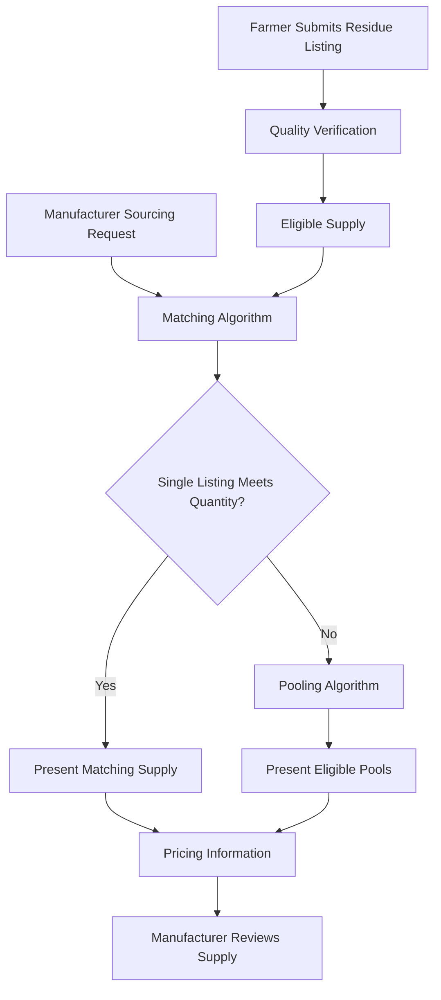

# Platform

---

title: Platform
description: Afyra's matching, pooling and pricing algorithms.

---

Afyra uses business rules and allocation logic to connect available crop residues with manufacturer demand.

This section documents the three core algorithms responsible for supply selection, aggregation and price estimation.

## Core Algorithms

| Algorithm                                | Purpose                                                           |
| ---------------------------------------- | ----------------------------------------------------------------- |
| [Matching Algorithm](/platform/matching) | Identify available supply that meets manufacturer requirements    |
| [Pooling Algorithm](/platform/pooling)   | Combine eligible supply from nearby farmers                       |
| [Pricing Algorithm](/platform/pricing)   | Estimate residue value using reference quotations and adjustments |

## How the Algorithms Work Together

Matching and pooling determine which supply can satisfy demand. Pricing provides the estimated value associated with eligible supply.

## Related Documentation

- [Backend](/backend/)
- [AI](/ai/)
- [ERD & Data Models](/architecture/data-models)
- [Integrations](/integrations/)
