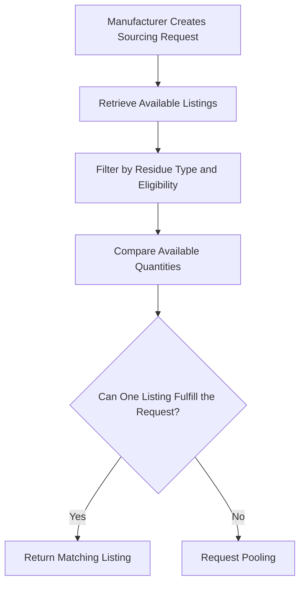

# Matching Algorithm

The matching algorithm identifies crop-residue listings that can satisfy a manufacturer's sourcing request.

Its purpose is to find suitable supply before determining whether multiple listings must be combined.

## Inputs

| Input              | Description                               |
| ------------------ | ----------------------------------------- |
| Residue type       | Material requested by the manufacturer    |
| Required quantity  | Quantity the manufacturer wants to source |
| Available listings | Farmer supply records                     |
| Listing quality    | Quality-verification outcome              |
| Listing status     | Whether the supply remains eligible       |
| Location           | Geographic information used for sourcing  |

## Matching Process

## Decision Logic

The documented workflow prioritizes finding a single listing capable of supplying the requested quantity.

If a suitable individual listing is unavailable, the system proceeds to pooling.

Quality information contributes to supply eligibility and ranking. The exact filtering and ranking rules should follow the implemented backend.

## Output

The matching process returns eligible supply information or passes the unfulfilled sourcing requirement to the pooling process.

The manufacturer can then review the available sourcing options.

## Example

A manufacturer requests **1,000 kg of maize stalks**.

If an eligible farmer has 1,000 kg available, the system can present that listing as a potential match.

If the available individual listings are smaller than the requested quantity, the system evaluates pooling options.

This example illustrates the documented workflow; it is not a recorded production transaction.

## Related Documentation

- [Pooling Algorithm](/platform/pooling)
- [Pricing Algorithm](/platform/pricing)
- [Backend](/backend/)
