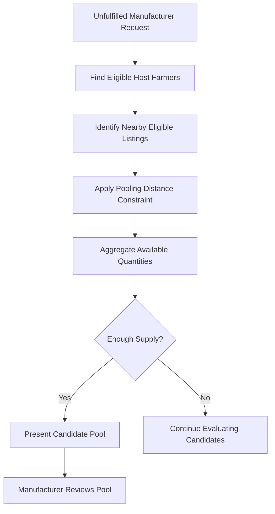

# Pooling Algorithm

The pooling algorithm is designed to combine smaller quantities of crop residues from nearby farmers to satisfy larger manufacturer sourcing requests.

It supports Afyra's micro-pooling approach, where an eligible host farmer acts as a collection point.

## Purpose

Individual farmers may have quantities too small to fulfill a manufacturer's request independently.

Pooling allows eligible listings to be considered together while coordinating collection around a shared location.

## Inputs

| Input                | Description                                    |
| -------------------- | ---------------------------------------------- |
| Manufacturer request | Required residue type and quantity             |
| Eligible listings    | Available farmer supply                        |
| Listing quantities   | Quantity contributed by each farmer            |
| Farmer locations     | Geographic coordinates                         |
| Host farmer          | Farmer eligible to serve as a collection point |
| Pooling radius       | Distance constraint used in grouping           |

## Pooling Radius

The Afyra data-model design specifies a **5 km pooling radius** around a host farmer.

This is a documented design parameter. Its value and enforcement should be verified in the backend implementation.

## Pooling Process

## Host Farmer

The host farmer provides a designated collection point for the pooled supply.

The documented workflow includes host-farmer consent and coordination with the assigned driver.

## Pooling Output

A candidate pool identifies the supply that may contribute to the manufacturer's request.

Relevant information includes:

- Participating listings.
- Contributed quantities.
- Total available quantity.
- Host collection point.
- Relevant quality information.

## Example

A manufacturer requires **1,000 kg of maize stalks**.

Three eligible farmers near an approved host location have:

| Farmer    | Available Quantity |
| --------- | -----------------: |
| Farmer A  |             400 kg |
| Farmer B  |             350 kg |
| Farmer C  |             250 kg |
| **Total** |       **1,000 kg** |

If all listings satisfy the eligibility and location rules, they can form a candidate pool.

This is an illustrative calculation, not actual Afyra listing data.

## After Pooling

Once the manufacturer confirms an eligible pool, the documented workflow proceeds to pickup scheduling, driver assignment and collection coordination.

## Related Documentation

- [Matching Algorithm](/platform/matching)
- [Pricing Algorithm](/platform/pricing)
- [Backend](/backend/)
- [Integrations](/integrations/)

## References & Live Docs

- Afyra Data Model Implementation - micro-pooling and host-farmer design.
- Afyra Feature Specification - F05 Matching and Pooling.
- [Afyra API Documentation](https://afyra-def6d466c54b.herokuapp.com/docs)
