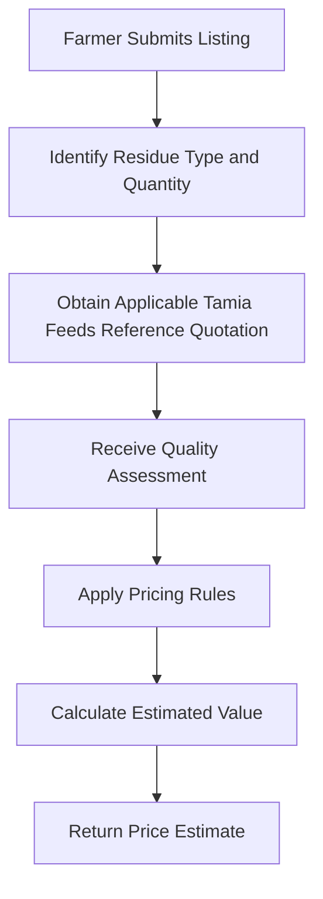

# Pricing Algorithm

Afyra's pricing approach estimates crop-residue value using **Tamia Feeds reference quotations** and rule-based adjustments for quality and quantity.

The goal is to provide an understandable estimate based on the characteristics of the listed supply.

## Pricing Approach

The planned pricing process uses reference quotations rather than treating Tamia Feeds as a live pricing API.

The previous HDX HAPI-based approach is being replaced by this quotation-based method.

## Pricing Inputs

| Input           | Purpose                                                |
| --------------- | ------------------------------------------------------ |
| Residue type    | Select the appropriate reference quotation             |
| Reference price | Provide the baseline pricing value                     |
| Quality         | Apply the Good or Bad quality adjustment               |
| Quantity        | Determine the total quantity and applicable adjustment |

## Quality Categories

Afyra uses exactly two business-facing quality categories.

| Category | Meaning                                                               |
| -------- | --------------------------------------------------------------------- |
| Good     | Material classified as meeting the applicable visual quality criteria |
| Bad      | Material classified as not meeting those criteria                     |

The ML integration may use `POOR` internally for the lower-quality class.

## Pricing Workflow

## Calculation Structure

At a conceptual level:

**Estimated Value = Reference Unit Price × Quantity × Applicable Adjustment Factors**

The adjustment factors represent the quality and quantity rules.

This equation illustrates the pricing structure. It does not establish the exact implemented formula.

## Reference Quotations

Tamia Feeds quotations serve as the reference source for baseline prices.

The pricing documentation should record:

- Residue type.
- Quoted unit price.
- Unit of measurement.
- Quotation date.
- Source reference.
- Applicable validity period, if provided.

Actual quotation values should be inserted only from approved Tamia Feeds material.

## Pricing Rules

The exact rules must be confirmed from the approved pricing specification or backend implementation.

| Rule                             | Status                           |
| -------------------------------- | -------------------------------- |
| Residue-specific reference price | Planned quotation-based approach |
| Good/Bad quality adjustment      | Required by pricing design       |
| Quantity adjustment              | Required by pricing design       |
| Exact adjustment percentages     | Not specified here               |
| Quotation update frequency       | Not specified here               |

## Relationship to AI

The ML model evaluates residue photographs and provides quality information.

The pricing algorithm uses the resulting quality category as one of its inputs.

**The pricing algorithm is rule-based; it is not a machine learning price-prediction model.**

## Related Documentation

- [AI](/ai/)
- [Integrations](/integrations/)
- [Backend](/backend/)
- [Matching Algorithm](/platform/matching)
- [Pooling Algorithm](/platform/pooling)
