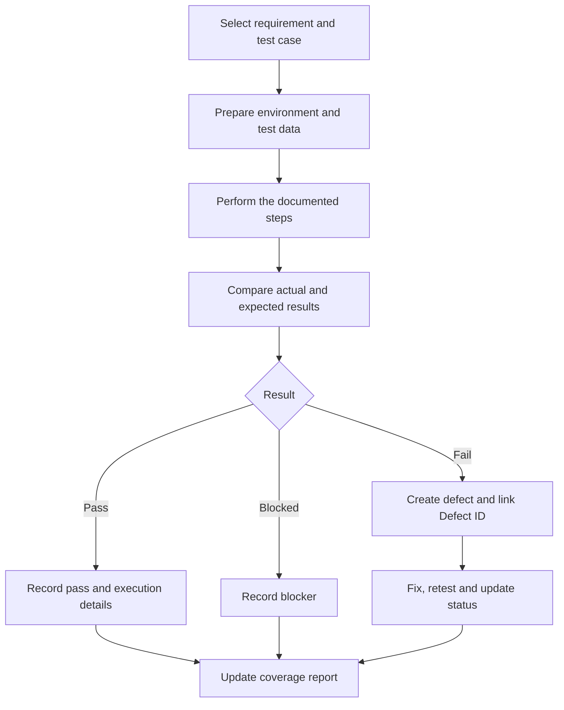

# Quality Assurance

## 1. Overview

Quality assurance (QA) for Afyra is organized around the features used by farmers, manufacturers, administrators and drivers. The aim is to check that each workflow meets its acceptance criteria, handles incorrect input safely, and behaves consistently across the mobile application, web application, backend and connected services.

The team's QA workbook, **Techelle_Afyra_Test_cases.xlsx**, contains requirements, feature ownership, detailed test cases, execution fields, automation planning, defect tracking and a calculated coverage report.

The workbook separates **test-case design and requirement coverage** from **test execution**. A requirement with a linked test case has been covered by the test plan; this does not by itself mean the feature has passed testing.

## 2. QA Scope

The workbook organizes testing into the following areas:

| Area                             | Main workflows                                                                    |
| -------------------------------- | --------------------------------------------------------------------------------- |
| Accounts and API platform        | User registration, authentication, permissions and API behaviour                  |
| Farmer supply listing            | Creating and managing crop-residue listings                                       |
| Quality verification and pricing | Image quality checks, grades and price-related behaviour                          |
| Market prices                    | Viewing and managing market-price information                                     |
| Matching and pooling             | Selecting available supply against a manufacturer's request                       |
| Batch details                    | Viewing quantities and details of pooled supply                                   |
| Purchase confirmation            | Confirming purchases and pickup dates                                             |
| SMS notifications                | Sending and handling notification events                                          |
| Driver registration              | Creating and managing driver accounts                                             |
| Dispatch and routing             | Assigning deliveries and tracking transport workflows                             |
| End-to-end journeys              | Cross-role workflows involving farmers, manufacturers, administrators and drivers |

The test cases reflect the requirements written in the workbook. Some descriptions use older terminology, such as **A/B/C quality grades**, while the current AI classifier uses **good/bad** labels. Before running those cases, the team should align the expected results with the agreed product requirements; changing a test case's wording must not silently change its requirement.

## 3. Requirements Traceability

Each test case links back to a requirement through a **Req ID** and to a feature through a **Feature ID**. This makes it possible to answer two questions:

1. Does every acceptance criterion have at least one test case?
2. Which test cases must be reviewed when a requirement changes?

The workbook's Coverage Report summarizes:

| Measure                       | Workbook value |
| ----------------------------- | -------------: |
| Acceptance criteria           |            104 |
| Requirement coverage          |           100% |
| Test cases                    |            145 |
| Manual test cases             |            104 |
| Planned automation test cases |             41 |
| Automated test cases          |              0 |

**100% requirement coverage** means each acceptance criterion is linked to at least one test case in the workbook. It is a test-design measure, not a claim that every feature works.

### Test-case distribution

| Workbook section        | Test cases |
| ----------------------- | ---------: |
| Accounts & Listing      |         47 |
| Quality & Market Prices |         28 |
| Pooling & Batch View    |         24 |
| Confirm & SMS Alerts    |         23 |
| Drivers & Dispatch      |         23 |
| **Total**               |    **145** |

## 4. Test Case Structure

Each test case is designed to be repeatable. The workbook provides these fields:

| Field                    | Purpose                                                       |
| ------------------------ | ------------------------------------------------------------- |
| TC ID                    | Unique identifier, such as `TC-M3-001`                        |
| Feature ID and Req ID    | Links to the feature and acceptance criterion                 |
| Title                    | Behaviour being checked                                       |
| Layer                    | Unit, API, integration, UI or end-to-end                      |
| Test type                | Functional, negative, boundary, security and other categories |
| Priority                 | Critical, high, medium or low                                 |
| Preconditions            | Setup required before the test starts                         |
| Steps                    | Actions for the tester to perform                             |
| Test data                | Values or accounts needed for the scenario                    |
| Expected result          | Correct system behaviour                                      |
| Execution method         | Manual, automated or planned automation                       |
| Actual result and status | What happened when the test was executed                      |
| Defect ID                | Link to a reported issue when applicable                      |

Test cases use member-specific IDs such as `TC-M1-`, `TC-M2-`, `TC-M3-`, `TC-M4-` and `TC-M5-` to avoid duplicates across the team.

## 5. Testing Levels and Types

### Unit testing

Checks a small part of the system in isolation. The workbook includes unit-level cases for rules such as pooling quantities and capacity limits.

### API testing

Checks request validation, permissions, responses and changes to stored data. Example scenarios include quality verification and account-related endpoints.

### Integration testing

Checks whether connected components exchange information correctly, including application-to-API flows and notifications.

### UI testing

Checks forms, navigation, displayed values, error messages and user actions in the mobile and web interfaces.

### End-to-end testing

Checks complete workflows across roles, such as listing residue, finding supply, confirming a purchase and coordinating pickup.

### Negative, boundary and security testing

Tests invalid inputs, duplicate submissions, capacity boundaries, authentication failures and attempts to enter unsafe text.

### Usability, accessibility and compatibility

The workbook also defines test types for usability, accessibility and compatibility. These help assess whether users can understand the workflows and whether the interfaces behave appropriately across supported devices and environments.

## 6. Example Test Scenarios From the Workbook

The following are examples of the behaviours specified in the test-case sheets; they are not presented as completed test runs.

| Area                  | Scenario                                                                                             |
| --------------------- | ---------------------------------------------------------------------------------------------------- |
| Quality verification  | Check that the interface displays the quality result and relevant explanation                        |
| Quality API           | Check that the quality endpoint and stored record retain the expected classification details         |
| Pooling               | Check that a proposed pool does not exceed the collection-yard capacity                              |
| Supply matching       | Check how the application displays a supply shortfall                                                |
| Purchase confirmation | Check that a pickup date is required and that listings are reserved after confirmation               |
| SMS                   | Check notifications associated with the purchase and pickup process                                  |
| Driver management     | Check registration, duplicate phone numbers and driver-capacity updates                              |
| Security              | Check that script-like input is treated safely and duplicate submissions do not create extra records |

For the precise preconditions, steps, test data and expected results, use the relevant test-case row in the workbook rather than shortening the case during execution.

## 7. Test Execution Workflow

The workbook supports a consistent execution process:

For each run, the tester records the actual result, status, executor and execution date. When a test fails, the related defect is entered in the **Defects** sheet and its identifier is added to the test case.

## 8. Automation Plan

The workbook separates manually executed scenarios from cases selected for future automation.

| Measure                              | Count |
| ------------------------------------ | ----: |
| Manual test cases                    |   104 |
| Planned automation                   |    41 |
| Automated test cases in the workbook |     0 |

The **Test Scripts** sheet is designed to connect automated scripts to their test cases. Its columns include script ID, feature, tool/framework, repository path, script status, last run date, result and runtime.

Automation should prioritize stable, repeatable checks such as input validation, API responses, permissions, pricing calculations and pooling rules. Usability observations and workflows requiring human judgement can remain manual.

## 9. Defect Management

The **Defects** sheet defines a consistent issue-reporting structure:

| Field                     | Meaning                                              |
| ------------------------- | ---------------------------------------------------- |
| Defect ID                 | Unique issue reference                               |
| Feature ID and TC ID      | Affected feature and test case                       |
| Title                     | Short description of the problem                     |
| Steps to reproduce        | Actions needed to see the problem                    |
| Expected / Actual         | Difference between correct and observed behaviour    |
| Severity                  | Critical, high, medium or low                        |
| Status                    | Open, in progress, fixed, retest, closed or rejected |
| Reported by / Assigned to | Responsibility for reporting and resolution          |
| Dates and notes           | Tracking and supporting context                      |

A defect is ready for retesting after the relevant fix has been delivered. The original test steps should be repeated, followed by relevant regression checks.

## 10. Coverage and Reporting

The Coverage Report calculates requirement coverage, execution coverage, pass rate, automation coverage, blocked cases and open defects.

| Measure                  | Meaning                                                          |
| ------------------------ | ---------------------------------------------------------------- |
| Requirement coverage     | Requirements linked to one or more test cases ÷ all requirements |
| Execution coverage       | Test cases with Pass or Fail results ÷ all test cases            |
| Pass rate                | Passed cases ÷ executed cases                                    |
| Automation coverage      | Automated cases ÷ all test cases                                 |
| Automation of candidates | Automated cases ÷ cases selected for automation                  |
| Open defects             | Defects that have not reached a closed or rejected status        |

The workbook's current calculated execution count is **0 Pass/Fail results**, so its pass-rate cell should not be interpreted as a measured product failure rate. The workbook is primarily evidence of the team's **test design, traceability and automation plan** at this stage.

The **Lists** sheet defines proposed reporting targets: 100% requirement coverage, 100% execution coverage, 95% pass rate, 60% automation coverage and 80% automation of selected candidates. These are targets for reporting, not achieved test results.

### QA Evidence and Verification Status

The figures in this documentation are reported from `Techelle_Afyra_Test_cases.xlsx`.

| Measure | Reported value | Interpretation |
|---|---:|---|
| Acceptance criteria | 104 | Requirements documented in the workbook |
| Requirement coverage | 100% | Acceptance criteria linked to test cases |
| Total test cases | 145 | Designed test cases |
| Manual test cases | 104 | Cases designated for manual testing |
| Planned automation | 41 | Cases selected for future automation |
| Automated cases recorded | 0 | No completed automation recorded in the reviewed workbook summary |
| Recorded Pass/Fail executions | 0 | No completed Pass/Fail results recorded in the reviewed workbook summary |

These figures describe the workbook's reported state. They have not been independently recalculated from the original spreadsheet during this documentation review.

Requirement coverage is not equivalent to successful test execution.

#### Evidence required for verification

To verify QA results, reviewers need access to:

- The original QA workbook and its latest revision.
- Requirement and test-case identifiers.
- Completed execution records with dates and results.
- Defect reports linked to failed tests.
- Automated test scripts and their execution reports, where available.

#### Reporting rules

- Do not report planned automation as completed automation.
- Do not report designed test cases as passed tests.
- Record execution results only after tests have been run.
- Keep failed, blocked and unexecuted cases distinguishable.
- Update the documented counts when the workbook changes.

The current QA documentation establishes the test strategy and planned coverage. Product readiness must be assessed using actual execution evidence.
I
## 11. Test Data and Evidence

Test cases specify the environment, accounts, devices, data and tools required to reproduce each scenario. Testers should use controlled test accounts and avoid exposing real user passwords, OTPs or private information in screenshots and reports.

Useful execution evidence includes:

- Screenshot or screen recording of the relevant UI behaviour.
- API request and response with secrets removed.
- Test run or console output for automated checks.
- Defect reference and steps to reproduce a failure.
- Date, environment and application version associated with the result.

Evidence should be linked to the appropriate test case or defect so another team member can verify the result.

