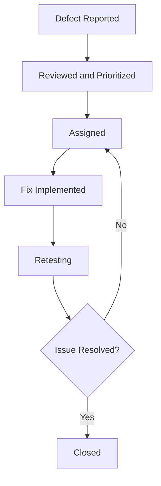

# Testing and Quality Assurance

## 1. Overview

Testing and Quality Assurance (QA) help ensure that Afyra works correctly, protects user information, and supports the workflows needed by farmers, manufacturers, drivers, and administrators.

Afyra consists of a Flutter mobile application, a Next.js web application, a FastAPI backend, a PostgreSQL database, and a crop-residue classification component.

Testing covers individual features, communication between components, user workflows, data validation, security, and usability.

This section explains the testing approach, representative test cases, how results are recorded, and how defects are managed.

**Evidence rule:** A test is only marked as passed when its actual result has been recorded and verified. Test cases without execution evidence are marked **Not recorded**, rather than being reported as successful.

## 2. Testing Objectives

The main objectives of QA are to:

- Verify that implemented features meet their requirements.
- Confirm that frontend applications communicate correctly with the backend.
- Check that user input is validated before processing.
- Verify that authentication and role-based permissions are enforced.
- Confirm that records are created, retrieved, and updated correctly.
- Check how the system handles empty data, network failures, and invalid requests.
- Evaluate crop-residue classification behavior using appropriate test images.
- Identify usability problems in important user workflows.
- Detect regressions when new changes are introduced.

## 3. Testing Scope

| Component                   | Testing Focus                                                                          |
| --------------------------- | -------------------------------------------------------------------------------------- |
| Flutter mobile application  | Navigation, forms, validation, state management, API integration, and device behavior  |
| Next.js web application     | Navigation, role-based interfaces, forms, API integration, and responsive behavior     |
| FastAPI backend             | Request validation, authentication, authorization, business logic, and error responses |
| PostgreSQL database         | Data persistence, relationships, constraints, and migrations                           |
| Crop-residue classification | Valid images, invalid images, prediction output, and classification errors             |
| External integrations       | Pricing sources, image storage, mapping, and SMS operations                            |
| End-to-end workflows        | Complete user actions across frontend, backend, and database                           |

Testing is performed against the features that are implemented and available in the selected environment. Planned features are not reported as tested.

## 4. Testing Levels

### 4.1 Unit Testing

Unit tests check individual functions or components independently.

Examples include:

- Validating a residue quantity.
- Checking a pricing calculation.
- Testing a ViewModel state transition.
- Validating a request schema.
- Checking how a service handles an empty response.

Unit tests help identify problems before multiple components are connected.

### 4.2 Integration Testing

Integration tests verify communication between components.

Examples include:

- Flutter service to FastAPI endpoint.
- FastAPI service to PostgreSQL repository.
- Web application to protected backend API.
- Backend to image storage.
- Backend to supplier-price collection service.

Integration testing checks whether data is passed correctly and errors are handled across component boundaries.

### 4.3 API Testing

API tests verify:

- HTTP methods and routes.
- Required parameters.
- Request and response schemas.
- Authentication.
- Authorization.
- Validation errors.
- Empty responses.
- Database operations.

API testing can be performed using Swagger UI, curl, Postman, and automated tests.

### 4.4 End-to-End Testing

End-to-end testing follows a complete user workflow.

For example:

1. A farmer authenticates.
2. The farmer registers a farm.
3. The application sends the request to FastAPI.
4. The backend validates and stores the information.
5. The application retrieves and displays the saved farm.

This checks whether the connected workflow works from the user's perspective.

### 4.5 Usability Testing

Usability testing evaluates whether users can complete important tasks without unnecessary confusion.

It focuses on:

- Understanding instructions.
- Finding the correct features.
- Completing forms.
- Recognizing errors.
- Understanding confirmation messages.
- Completing tasks without facilitator assistance.

Usability observations should be recorded separately from automated functional test results.

### 4.6 Regression Testing

Regression testing checks whether existing functionality still works after code changes.

Regression checks are especially important after changes to:

- Authentication and authorization.
- Shared API clients.
- Database schemas.
- Pricing calculations.
- Shared frontend components.
- Navigation and user roles.

## 5. Testing Tools

| Tool                       | Component                              | Purpose                             |
| -------------------------- | -------------------------------------- | ----------------------------------- |
| Flutter Test               | Mobile                                 | Widget and application tests        |
| Flutter Analyze            | Mobile                                 | Static analysis                     |
| Dart Format                | Mobile                                 | Code formatting checks              |
| Playwright                 | Web, where configured                  | Browser-based automated testing     |
| FastAPI TestClient / HTTPX | Backend, where configured              | API testing                         |
| Pytest                     | Backend                                | Automated Python tests              |
| Swagger UI                 | Backend                                | Manual API inspection and execution |
| PostgreSQL                 | Backend                                | Database-dependent testing          |
| GitHub Actions             | Repositories with configured workflows | Automated checks during development |

A tool is included here as part of the testing approach. Its presence in this table does not mean it has been configured or executed in every repository.

## 6. Test Environment

Tests should record the environment in which they were performed.

| Item                | Information to Record                    |
| ------------------- | ---------------------------------------- |
| Test date           | Date of execution                        |
| Application version | Commit hash, branch, or release          |
| Environment         | Local, staging, or deployed              |
| Mobile device       | Device model and operating system        |
| Browser             | Browser and version                      |
| Backend             | Running API version and URL              |
| Database            | Test database and migration state        |
| Test account        | Role used, without recording credentials |
| Tester              | Person responsible for execution         |

### Test Data

Testing should use controlled test accounts and records.

Examples include:

- A farmer test account.
- A manufacturer test account.
- A driver test account.
- An administrator test account.
- A test farm.
- A residue type already present in the test database.
- Valid and invalid image samples.

Do not use production credentials or sensitive user information in published test evidence.

Do not invent database records to claim that a feature was successfully tested.

## 7. Functional Test Cases

The following cases provide a reusable test suite for Afyra.

They describe expected behavior. Their execution status must be updated using actual test evidence.

### 7.1 Authentication and Authorization

| ID      | Test Case                                                  | Expected Result                                                       | Execution Status |
| ------- | ---------------------------------------------------------- | --------------------------------------------------------------------- | ---------------- |
| AUTH-01 | Log in with valid credentials                              | User is authenticated and can access permitted features               | Not recorded     |
| AUTH-02 | Log in with an incorrect password                          | Login is rejected with an appropriate error                           | Not recorded     |
| AUTH-03 | Access a protected endpoint without authentication         | Request is rejected                                                   | Not recorded     |
| AUTH-04 | Access an administrator endpoint using a non-admin account | Access is denied                                                      | Not recorded     |
| AUTH-05 | Access a protected endpoint with an expired token          | Request is rejected or handled through the configured refresh process | Not recorded     |

### 7.2 Farm Management

| ID      | Test Case                                  | Expected Result                                                     | Execution Status |
| ------- | ------------------------------------------ | ------------------------------------------------------------------- | ---------------- |
| FARM-01 | Register a farm using valid data           | Farm is created and returned or made available for retrieval        | Not recorded     |
| FARM-02 | Submit a farm with missing required fields | Backend rejects the invalid request                                 | Not recorded     |
| FARM-03 | Submit invalid coordinate values           | Validation prevents invalid farm registration                       | Not recorded     |
| FARM-04 | Retrieve farms for the authenticated user  | Relevant farm records are returned                                  | Not recorded     |
| FARM-05 | Submit the same farm form repeatedly       | Application handles repeated submissions according to backend rules | Not recorded     |

### 7.3 Residue Catalog

| ID     | Test Case                                       | Expected Result                      | Execution Status |
| ------ | ----------------------------------------------- | ------------------------------------ | ---------------- |
| CAT-01 | Request residue types                           | API returns HTTP 200 and a list      | Not recorded     |
| CAT-02 | Request residue types when the catalog is empty | API returns an empty array           | Not recorded     |
| CAT-03 | Display an empty residue catalog in Flutter     | User sees an appropriate empty state | Not recorded     |
| CAT-04 | Create a residue type as an administrator       | Valid request creates a residue type | Not recorded     |
| CAT-05 | Create a residue type with an invalid name      | Backend rejects invalid input        | Not recorded     |

### 7.4 Pricing

| ID       | Test Case                               | Expected Result                                                   | Execution Status |
| -------- | --------------------------------------- | ----------------------------------------------------------------- | ---------------- |
| PRICE-01 | Request a quote with valid parameters   | API returns the defined quote structure                           | Not recorded     |
| PRICE-02 | Request a quote with no available price | Missing price is represented without a fabricated amount          | Not recorded     |
| PRICE-03 | Estimate a price using good quality     | API returns an estimate with `quality: good`                      | Not recorded     |
| PRICE-04 | Estimate a price using bad quality      | API returns an estimate with `quality: bad`                       | Not recorded     |
| PRICE-05 | Submit zero or negative weight          | API rejects the request                                           | Not recorded     |
| PRICE-06 | Submit an unsupported grade             | API rejects the request                                           | Not recorded     |
| PRICE-07 | Retrieve a stale reference price        | Response identifies the price as stale according to backend rules | Not recorded     |

### 7.5 Residue Listings

| ID      | Test Case                                          | Expected Result                                            | Execution Status |
| ------- | -------------------------------------------------- | ---------------------------------------------------------- | ---------------- |
| LIST-01 | Create a listing with valid required information   | Listing is created                                         | Not recorded     |
| LIST-02 | Submit a listing with missing required information | Submission is rejected or prevented                        | Not recorded     |
| LIST-03 | Upload a supported residue image                   | Image is accepted and processed by the configured workflow | Not recorded     |
| LIST-04 | Upload an unsupported file                         | File is rejected safely                                    | Not recorded     |
| LIST-05 | Retrieve the user's listings                       | Relevant listings are displayed                            | Not recorded     |

### 7.6 Manufacturer and Collection Workflows

| ID     | Test Case                                              | Expected Result                                          | Execution Status |
| ------ | ------------------------------------------------------ | -------------------------------------------------------- | ---------------- |
| SRC-01 | Submit a valid sourcing request                        | Request is created according to backend rules            | Not recorded     |
| SRC-02 | Submit invalid sourcing data                           | Validation rejects the request                           | Not recorded     |
| COL-01 | View an assigned collection                            | Authorized user can retrieve the assignment              | Not recorded     |
| COL-02 | Attempt to access another user's restricted collection | Authorization prevents access                            | Not recorded     |
| COL-03 | Submit a collection status change                      | Valid transition is processed according to backend rules | Not recorded     |

These cases must be matched to the implemented sourcing and collection workflows before execution.

## 8. API Test Cases

The following cases focus on backend endpoints whose contracts have been reviewed.

| ID     | Endpoint                    | Test Input                      | Expected Result                         |
| ------ | --------------------------- | ------------------------------- | --------------------------------------- |
| API-01 | `GET /counties`             | No parameters                   | HTTP 200 with an array of county names  |
| API-02 | `GET /residue-types`        | No parameters                   | HTTP 200 with an array of residue types |
| API-03 | `POST /admin/residue-types` | Valid administrator request     | HTTP 201 with created residue type      |
| API-04 | `POST /admin/residue-types` | Name shorter than 2 characters  | HTTP 422 validation error               |
| API-05 | `GET /prices/quote`         | Valid authenticated request     | HTTP 200 with quote schema              |
| API-06 | `GET /prices/estimate`      | Positive weight and valid grade | HTTP 200 with estimate schema           |
| API-07 | `GET /prices/estimate`      | `weight_kg=0`                   | HTTP 422 validation error               |
| API-08 | `GET /prices/estimate`      | `grade=EXCELLENT`               | HTTP 422 validation error               |
| API-09 | `GET /admin/market-prices`  | Non-admin account               | Request denied                          |
| API-10 | `POST /admin/market-prices` | Negative price                  | HTTP 422 validation error               |

These are expected outcomes based on the reviewed API contracts, not a report of completed test executions.

## 9. Machine Learning Testing

Afyra's crop-residue classification component should be tested independently and through its application integration.

### 9.1 Functional Inference Tests

| ID    | Test Case                                    | Expected Result                                                            | Execution Status |
| ----- | -------------------------------------------- | -------------------------------------------------------------------------- | ---------------- |
| ML-01 | Submit a supported crop-residue image        | Model returns a prediction in the configured output format                 | Not recorded     |
| ML-02 | Submit an unsupported file                   | Request is rejected safely                                                 | Not recorded     |
| ML-03 | Submit a corrupted image                     | Application handles the failure without crashing                           | Not recorded     |
| ML-04 | Submit an image with unclear residue content | System handles the prediction according to its confidence and error rules  | Not recorded     |
| ML-05 | Model weights are unavailable                | Application reports an inference failure without exposing internal details | Not recorded     |

### 9.2 Model Evaluation

Model evaluation should use a labeled dataset separate from training data.

Record:

- Dataset name and source.
- Number of evaluation images.
- Class distribution.
- Model version.
- Evaluation date.
- Accuracy.
- Precision.
- Recall.
- F1-score.
- Confusion matrix.
- Misclassification examples.

No accuracy or other model-performance metric should be published without the corresponding evaluation results.

### 9.3 Misclassification Handling

When a prediction is incorrect, record:

1. The input image reference.
2. The expected class.
3. The predicted class.
4. The confidence score, if provided.
5. The error category.
6. Whether the user can correct or retry the result.
7. Whether the issue requires a model or application change.

Avoid treating a successful HTTP response as proof that the model prediction is correct.

## 10. Integration Testing

Integration tests verify that connected components work together.

| ID     | Integration                    | Test Scenario                    | Expected Result                                              |
| ------ | ------------------------------ | -------------------------------- | ------------------------------------------------------------ |
| INT-01 | Flutter → FastAPI              | Retrieve residue catalog         | Flutter receives and displays the API response               |
| INT-02 | Flutter → FastAPI → PostgreSQL | Register a farm                  | Valid farm data is stored and retrievable                    |
| INT-03 | Next.js → FastAPI              | Make an authenticated request    | Backend validates authentication and returns authorized data |
| INT-04 | FastAPI → Pricing Service      | Retrieve reference price         | Available price or supported unavailable state is returned   |
| INT-05 | FastAPI → Image Storage        | Upload an accepted image         | Image is handled by the configured storage workflow          |
| INT-06 | FastAPI → SMS Provider         | Trigger an eligible notification | Provider response and failure handling are recorded          |

Integration test results must include the actual environment and observed outcome.

## 11. Usability Testing

Usability testing focuses on whether target users can complete important tasks using Afyra.

### Testing Approach

The planned usability study uses:

- **Duration:** Two days.
- **Method:** In-person moderated sessions.
- **Participants:** A mix of real users and suitable proxies.
- **Session length:** Approximately 25–30 minutes.
- **Accounts:** Pre-created test accounts.
- **Tasks:** Three core tasks per participant role.
- **Success criteria:** Improvement-focused, emphasizing usability problems and opportunities for improvement.

### Participant Roles

Recruit participants who represent the relevant Afyra workflows:

- Farmers.
- Manufacturers.
- Drivers.
- Administrators, where administrative workflows are included.

Suitable proxies should have enough familiarity with the role's activities to provide useful feedback.

### Session Structure

| Stage               | Suggested Duration | Activity                                        |
| ------------------- | ------------------ | ----------------------------------------------- |
| Introduction        | 3 minutes          | Explain the session and obtain consent          |
| Task execution      | 18–21 minutes      | Participant completes three tasks               |
| Follow-up questions | 4 minutes          | Discuss confusing steps and suggestions         |
| Closing             | 2 minutes          | Thank participant and record final observations |

### Observation Criteria

For each task, record:

- Whether the participant completed it.
- Whether assistance was needed.
- Errors encountered.
- Navigation difficulties.
- Confusing labels or instructions.
- Time taken, where practical.
- Participant comments.
- Suggested improvements.

The purpose is to identify usability improvements, not to claim that every participant must complete every task without difficulty.

### Usability Results

Actual participant counts, task outcomes, observations, and findings must be added after the study.

Do not present the planned study as completed testing.

## 12. Test Execution Results

This section is used to record real testing evidence.

### Current Evidence Status

The reviewed backend source confirms the presence of catalog-related test code, including:

```text
tests/test_catalog.py
```

A known test is:

```text
test_residue_types_are_public
```

This establishes that the test exists in the backend source. It does not establish whether it passed during the latest execution.

### Execution Summary

| Component            | Test Evidence                       | Result                        |
| -------------------- | ----------------------------------- | ----------------------------- |
| Backend catalog      | Test file and named test identified | Execution result not recorded |
| Backend pricing      | Endpoint schemas reviewed           | Execution result not recorded |
| Flutter mobile       | Test commands documented            | Execution result not recorded |
| Next.js web          | Test approach documented            | Execution result not recorded |
| Machine learning     | Evaluation requirements identified  | Metrics not supplied          |
| End-to-end workflows | Representative cases defined        | Execution result not recorded |
| Usability testing    | Study plan defined                  | Findings not supplied         |

Update this table when actual test reports, terminal outputs, CI results, or signed observation sheets become available.

### Test Execution Record

Use the following format for each executed test:

| Field                         | Value                           |
| ----------------------------- | ------------------------------- |
| Test ID                       |                                 |
| Test date                     |                                 |
| Tester                        |                                 |
| Environment                   |                                 |
| Application version or commit |                                 |
| Test data                     |                                 |
| Expected result               |                                 |
| Actual result                 |                                 |
| Status                        | Pass / Fail / Blocked / Not Run |
| Evidence                      |                                 |
| Defect reference              |                                 |

## 13. Running Automated Tests

### Flutter

Run static analysis:

```bash
flutter analyze
```

Run configured tests:

```bash
flutter test
```

Check formatting:

```bash
dart format --output=none --set-exit-if-changed lib
```

### Backend

Run catalog tests:

```bash
pytest tests/test_catalog.py -v
```

Run the complete configured test suite:

```bash
pytest
```

### Next.js

Run the production build:

```bash
npm run build
```

Run other tests and linting commands only if they are defined in the web repository.

### Recording Results

For each execution, save:

- Command used.
- Date and environment.
- Commit hash.
- Number of tests passed.
- Number of tests failed.
- Number of tests skipped.
- Relevant failure logs.

Do not label a build check as an end-to-end test.

## 14. Defect Management

A defect is recorded when actual behavior differs from the expected result.

### Defect Severity

| Severity | Description                                                      | Example                                   |
| -------- | ---------------------------------------------------------------- | ----------------------------------------- |
| Critical | Prevents a core workflow or creates a serious security/data risk | Unauthorized access to restricted records |
| High     | Major functionality is broken                                    | Farmer cannot register a valid farm       |
| Medium   | Feature works incorrectly but has a workaround                   | Incorrect validation message              |
| Low      | Minor issue with limited functional impact                       | Misaligned button or inconsistent label   |

### Defect Report Template

```text
Defect ID:
Title:
Reported by:
Date:
Environment:
Affected component:
Severity:
Priority:

Preconditions:

Steps to Reproduce:
1.
2.
3.

Expected Result:

Actual Result:

Evidence:

Assigned Developer:

Status:

Retest Result:
```

### Defect Lifecycle



A defect should only be closed after the fix has been verified.

## 15. Release Validation

Before a release, the team should verify that:

- [ ] Core user workflows have been tested.
- [ ] Authentication and authorization checks pass.
- [ ] Critical and high-severity defects are resolved or explicitly assessed.
- [ ] Database migrations have been validated.
- [ ] Frontend applications connect to the correct backend environment.
- [ ] Empty and error states are handled.
- [ ] Image upload and classification behavior have been checked where applicable.
- [ ] External integrations have been checked in the intended environment.
- [ ] Automated test results have been recorded.
- [ ] Known limitations have been documented.
- [ ] The release decision is supported by actual testing evidence.

A release should not be described as fully tested when required checks remain unexecuted.

## 16. Known Limitations

The following documentation limitations remain until supporting evidence is added:

- Actual automated test execution summaries are not included.
- Test coverage percentages have not been verified.
- Machine learning evaluation metrics have not been supplied.
- Usability participant results and findings have not been added.
- External integration test outcomes have not been confirmed.
- The latest release's full regression results have not been provided.

These limitations describe the available QA evidence, not necessarily defects in the Afyra application.

## 17. Related Documentation

- [Developer Guide](/developer-guide/)
- [API Documentation](/backend/api-documentation)
- [Backend Overview](/backend/)
- [Frontend Mobile](/frontend-mobile/)
- [Frontend Web](/frontend-web/)
- [System Architecture](/architecture/sad)
- [AI](/ai/)
- [Security](/security/)
- [Integrations](/integrations/)
