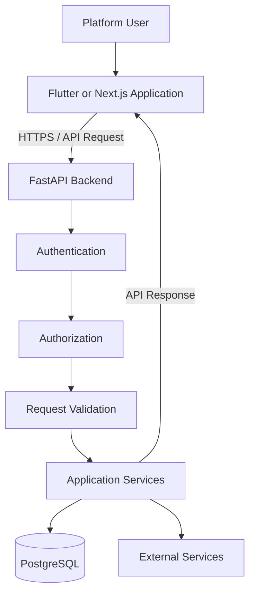
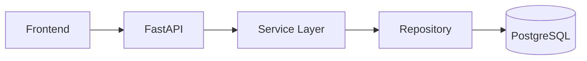
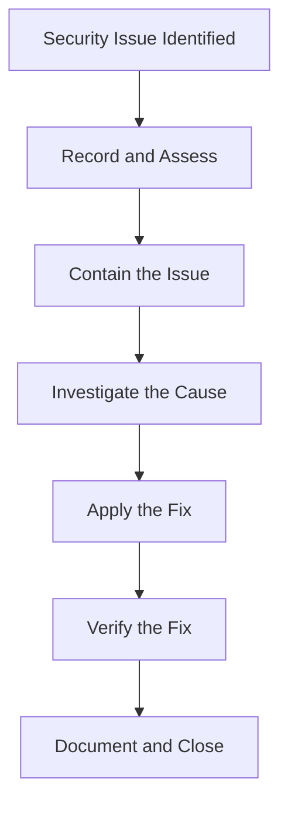

# Security

## 1. Overview

Security is important in Afyra because the platform processes user accounts, contact information, farm locations, residue images, sourcing requests, and delivery information.

Afyra uses a FastAPI backend that provides authentication and authorization for protected operations. The Flutter mobile application and Next.js web application communicate with the backend through API endpoints.

The main security objectives are to:

- Prevent unauthorized access to user accounts.
- Restrict operations according to user roles.
- Protect authentication credentials and tokens.
- Validate information submitted to the backend.
- Protect personal and location information.
- Control access to uploaded images.
- Protect credentials used by external integrations.
- Handle errors without exposing sensitive internal information.
- Verify security controls through testing.

This document distinguishes between security features defined by the API contract, recommended practices, and implementation details that still require verification.

## 2. Security Architecture

Afyra applies security controls at different application layers.



This diagram represents the main security responsibilities. Public endpoints do not require authentication, and the exact execution order of authentication, dependency validation, and request validation depends on the FastAPI implementation.

### Security Responsibilities

| Layer                 | Responsibility                                                             |
| --------------------- | -------------------------------------------------------------------------- |
| Flutter mobile        | Handles user input, authentication state, and protected feature access     |
| Next.js web           | Handles web sessions, authenticated requests, and role-specific interfaces |
| FastAPI               | Validates requests and enforces authentication and authorization           |
| PostgreSQL            | Stores structured application records                                      |
| Image storage         | Stores uploaded residue photographs                                        |
| External integrations | Communicate with configured third-party services                           |

Frontend restrictions improve the user experience, but backend authorization is required to protect resources.

## 3. Authentication

Authentication verifies the identity of a user before allowing access to protected functionality.

The Afyra OpenAPI specification defines bearer-token authentication.

### 3.1 Login

**Endpoint**

```http
POST /auth/login
```

**Request example**

```json
{
  "phone_number": "0712345678",
  "password": "EXAMPLE_PASSWORD"
}
```

The backend returns a token pair when authentication succeeds.

The response includes:

- `access_token`
- `refresh_token`
- `token_type`
- `expires_in_seconds`
- `user`

The user object contains account information such as the user's ID, role, name, phone number, and status.

### 3.2 Access Tokens

Access tokens are used when making protected API requests.

```http
Authorization: Bearer ACCESS_TOKEN
```

Example:

```bash
curl -X GET "$BASE_URL/auth/me" \
  -H "Authorization: Bearer ACCESS_TOKEN"
```

The backend validates the token before allowing access to protected operations.

A token should never be included in:

- Public GitHub repositories.
- Screenshots shared publicly.
- Documentation examples using real credentials.
- Application error messages.
- Unprotected log files.

### 3.3 Refresh Tokens

The API provides:

```http
POST /auth/refresh
```

This endpoint accepts a refresh token and returns a token pair.

Refresh tokens allow the application to obtain new authentication credentials according to the backend's session rules.

The actual expiration, rotation, and revocation behavior must be verified from the authentication implementation.

### 3.4 Logout

The API provides:

```http
POST /auth/logout
```

The frontend should clear its authentication state after a successful logout.

Whether logout also revokes a token on the server must be confirmed from the backend implementation.

### 3.5 Account Verification and Recovery

The API includes endpoints for:

- Phone verification.
- Resending verification codes.
- Account activation.
- Forgotten-password requests.
- Password resets.

These operations help users complete account setup and recover access.

The verification-code lifetime, maximum attempts, and rate-limiting rules must be confirmed from the backend configuration.

## 4. Authorization and Role-Based Access Control

Authorization determines which resources and operations an authenticated user can access.

Afyra supports different account roles.

| Role                | Main Access                                                     |
| ------------------- | --------------------------------------------------------------- |
| `FARMER`            | Farm registration and residue-listing workflows                 |
| `MANUFACTURER`      | Manufacturer profile, sourcing, and pickup-related workflows    |
| `DRIVER`            | Assigned pickup and location-update workflows                   |
| `ADMIN`             | Authorized administrative operations                            |
| Super administrator | Administrator onboarding and higher-level administrative access |

The API includes a super-administrator indicator in its user information.

### 4.1 Administrative Access

Administrative endpoints include:

```http
GET /admin/dashboard
GET /admin/users
GET /admin/audit-log
POST /admin/residue-types
```

These operations require the appropriate permissions.

The API also provides operations for suspending and reactivating users.

### 4.2 Administrator Onboarding

The user creation API includes an administrator invitation workflow.

Administrator invitations require super-administrator authorization.

This means ordinary users should not be able to create administrator accounts through unrestricted self-registration.

### 4.3 Driver Onboarding

The API also defines a driver invitation workflow associated with manufacturer authorization.

The backend must enforce the appropriate permissions rather than trusting a role selected in the frontend.

### 4.4 Access Control Principle

Every protected operation should check whether the authenticated user has permission to perform it.

For example, an authenticated farmer should not be able to access administrator-only operations simply by changing the URL or manually sending an HTTP request.

## 5. Password Security

Passwords are sensitive authentication credentials.

The backend provides:

```http
POST /users/me/password
```

This allows an authenticated user to change their password according to the endpoint's requirements.

### Password Protection Requirements

A secure password implementation should:

1. Store password hashes rather than plaintext passwords.
2. Use an established password-hashing algorithm.
3. Avoid including passwords in API responses.
4. Avoid writing passwords to application logs.
5. Validate password-change requests.
6. Protect password-reset operations against unauthorized use.

The available API specification confirms password-related endpoints but does not identify the hashing algorithm used.

The actual algorithm, password policy, and reset-token handling must be verified from the authentication service.

### Frontend Password Handling

The frontend should:

- Use password input fields that hide entered characters.
- Avoid displaying passwords in error messages.
- Avoid hardcoding credentials.
- Clear sensitive input when appropriate.
- Use the established authentication service.

## 6. API Security

FastAPI is the central entry point for backend operations.

API security includes authentication, authorization, input validation, and appropriate error handling.

### 6.1 Protected Endpoints

Protected endpoints require the authentication mechanism defined by the backend.

Example:

```http
GET /farms
Authorization: Bearer ACCESS_TOKEN
```

Requests without valid authorization should be rejected according to the endpoint's security rules.

### 6.2 Input Validation

Afyra uses Pydantic schemas to validate incoming request data.

Validation rules include:

- Required fields.
- Supported data types.
- String length constraints.
- Allowed enumeration values.
- Positive quantities.
- Valid date formats.
- Coordinate requirements.

For example, the pricing estimate endpoint requires:

```http
GET /prices/estimate
```

With the parameters:

```text
residue_type_id
county
weight_kg
grade
```

The `weight_kg` value must be greater than zero.

The `grade` parameter accepts only:

```text
GOOD
POOR
```

Invalid values should be rejected before they are used in pricing calculations.

### 6.3 HTTP Status Codes

| Status Code | Security or Validation Meaning             |
| ----------- | ------------------------------------------ |
| 400         | Invalid request or business-rule violation |
| 401         | Authentication required or invalid         |
| 403         | Insufficient permissions                   |
| 404         | Requested resource not found               |
| 409         | Conflicting operation                      |
| 422         | Request validation failed                  |
| 429         | Too many requests                          |

Actual status codes depend on the endpoint.

### 6.4 Error Responses

Many Afyra endpoints define an error structure similar to:

```json
{
  "error": {
    "code": "EXAMPLE_ERROR",
    "message": "The request could not be completed.",
    "details": null
  }
}
```

Some endpoints use FastAPI's standard validation-error structure instead.

The frontend should handle the documented response for each endpoint.

Error responses should not expose passwords, authentication tokens, database connection strings, or internal secrets.

## 7. User Data Protection

Afyra processes information associated with platform users and their activities.

Examples include:

| Data              | Purpose                          |
| ----------------- | -------------------------------- |
| Names             | Account identification           |
| Phone numbers     | Authentication and communication |
| User roles        | Authorization                    |
| Farm details      | Farm registration and management |
| Farm coordinates  | Location-related operations      |
| Residue listings  | Agricultural supply information  |
| Sourcing requests | Manufacturer procurement         |
| Driver locations  | Pickup and delivery coordination |

### Data Protection Principles

The application should follow these principles:

**Data minimization**

Collect only information required for the intended operation.

**Access limitation**

Allow users to access only the information they are authorized to view or modify.

**Secure transmission**

Use HTTPS for deployed API communication.

**Secure storage**

Protect stored information through database access controls and appropriate infrastructure configuration.

**Safe logging**

Avoid logging passwords, authentication tokens, and unnecessary personal information.

**Controlled retention**

Define how long personal information and location history should be retained.

The current API specification does not establish the platform's complete retention or deletion policy.

These policies must be documented separately from the actual organizational requirements and implementation.

## 8. Location Data Security

Afyra uses location information for farms, sourcing, collections, and driver operations.

Location information can reveal sensitive details about users and their activities.

### Location-Related API Operations

The backend includes:

```http
PUT /drivers/me/location
```

The request accepts latitude and longitude.

Farm registration also includes location coordinates.

### Security Considerations

- Location updates should be associated with an authenticated and authorized user.
- Location data should only be accessible to users who need it for a permitted workflow.
- Coordinates should be validated before storage.
- Sensitive location information should not be unnecessarily exposed in logs.
- Location history retention should be defined.

The exact permissions and retention behavior must be confirmed from the backend implementation.

## 9. Image Upload Security

Farmers submit crop-residue images when creating listings.

The API requires three image fields:

```text
photo_macro
photo_core
photo_base
```

The listing endpoint accepts multipart form data.

### Upload Security Risks

Image uploads can introduce risks such as:

- Unsupported file formats.
- Oversized files.
- Corrupted files.
- Malicious files disguised as images.
- Unauthorized access to stored images.
- Accidental exposure of storage credentials.

### Recommended Upload Controls

The backend should:

1. Validate uploaded file types.
2. Check file contents rather than trusting only file extensions.
3. Enforce appropriate file-size limits.
4. Reject corrupted or unsupported files.
5. Use controlled file identifiers.
6. Prevent unauthorized access to private images.
7. Handle storage failures safely.
8. Avoid exposing storage credentials.

### AWS S3

Afyra uses AWS S3 for image storage.

Security considerations include:

- Keeping AWS credentials outside public source code.
- Limiting permissions to required operations.
- Configuring bucket access appropriately.
- Controlling how image URLs are generated and shared.
- Avoiding unintended public access.

The actual S3 bucket policy, object permissions, encryption settings, and signed-URL behavior must be verified from the deployment configuration.

## 10. Database Security

PostgreSQL stores structured application records.

Database security depends on the backend implementation and infrastructure configuration.

### Recommended Controls

- Restrict database connections to authorized services.
- Keep database credentials in environment configuration.
- Do not expose database connection strings in frontend applications.
- Use parameterized database operations.
- Apply database migrations in a controlled manner.
- Restrict database-user privileges.
- Protect backups.
- Avoid logging sensitive database values.

### Database Access Flow



Frontend applications should not connect directly to PostgreSQL.

The backend manages database operations through its configured data-access layer.

## 11. External Integration Security

Afyra integrates with external services for pricing, messaging, mapping, and image storage.

| Integration | Security Consideration                                 |
| ----------- | ------------------------------------------------------ |
| AWS S3      | Storage credentials and object access                  |
| SMS Leopard | API credentials and recipient information              |
| Google Maps | API-key restrictions and location information          |
| Tamia Feeds | Safe handling of supplier data and collection requests |

### Credential Management

External service credentials should be:

- Stored outside source code.
- Restricted to the required permissions.
- Different between environments where appropriate.
- Excluded from logs.
- Rotated if compromised.

### External Data Validation

Information received from external services should be treated as external input.

For example, supplier prices should be checked and processed according to the pricing service's validation rules.

An external response should not automatically be considered trustworthy merely because it comes from a configured provider.

## 12. Frontend Security

### 12.1 Flutter Mobile Application

The mobile application should protect authentication information and handle protected operations through its existing API services.

Important checks include:

- Secure handling of authentication tokens.
- Avoiding credentials in application logs.
- Correct handling of session expiration.
- Validation of user input.
- Appropriate error messages.
- Prevention of unauthorized access to protected operations.

The actual token-storage mechanism must be confirmed from the Flutter implementation.

### 12.2 Next.js Web Application

The web application should:

- Use its established authentication and session-management mechanism.
- Protect server-side secrets.
- Avoid exposing sensitive environment variables to browser code.
- Validate user input.
- Handle authorization failures.
- Restrict administrative operations.
- Protect session cookies where applicable.

Where Next.js route handlers forward requests to FastAPI, they should follow the project's existing session and token-handling design.

The presence of a frontend role check does not replace backend authorization.

## 13. Security Testing

Security testing verifies that the application enforces its intended protections.

### Authentication Test Cases

| ID     | Test Case                                   | Expected Result                                                  | Status       |
| ------ | ------------------------------------------- | ---------------------------------------------------------------- | ------------ |
| SEC-01 | Access a protected endpoint without a token | Request is rejected                                              | Not recorded |
| SEC-02 | Use an invalid access token                 | Request is rejected                                              | Not recorded |
| SEC-03 | Use an expired access token                 | Request is rejected or handled by the configured refresh process | Not recorded |
| SEC-04 | Log in with incorrect credentials           | Authentication fails                                             | Not recorded |
| SEC-05 | Attempt an unauthorized password change     | Request is rejected                                              | Not recorded |

### Authorization Test Cases

| ID     | Test Case                                                 | Expected Result                                      | Status       |
| ------ | --------------------------------------------------------- | ---------------------------------------------------- | ------------ |
| SEC-06 | Farmer accesses administrator dashboard API               | Access denied                                        | Not recorded |
| SEC-07 | Non-admin creates a residue type                          | Access denied                                        | Not recorded |
| SEC-08 | Unauthorized user attempts administrator invitation       | Access denied                                        | Not recorded |
| SEC-09 | User attempts to access another user's restricted records | Access denied                                        | Not recorded |
| SEC-10 | Suspended user attempts a restricted operation            | Backend enforces the applicable account-status rules | Not recorded |

### Input and Upload Test Cases

| ID     | Test Case                        | Expected Result                                 | Status       |
| ------ | -------------------------------- | ----------------------------------------------- | ------------ |
| SEC-11 | Submit invalid pricing quantity  | Validation rejects request                      | Not recorded |
| SEC-12 | Submit unsupported pricing grade | Validation rejects request                      | Not recorded |
| SEC-13 | Upload unsupported file type     | File rejected safely                            | Not recorded |
| SEC-14 | Upload corrupted image           | Error handled without exposing internal details | Not recorded |
| SEC-15 | Submit malformed API payload     | Request rejected safely                         | Not recorded |

### Session and Data Protection Tests

| ID     | Test Case                                           | Expected Result                                       | Status       |
| ------ | --------------------------------------------------- | ----------------------------------------------------- | ------------ |
| SEC-16 | Log out and attempt to reuse the previous session   | Behavior follows verified logout and revocation rules | Not recorded |
| SEC-17 | Inspect browser-accessible data for exposed secrets | No sensitive server credentials exposed               | Not recorded |
| SEC-18 | Inspect application logs                            | Passwords and tokens are not exposed                  | Not recorded |
| SEC-19 | Attempt unauthorized access to stored images        | Access follows configured image permissions           | Not recorded |
| SEC-20 | Attempt unauthorized driver-location access         | Access denied                                         | Not recorded |

These cases are test specifications, not completed test results.

## 14. Security Incident Handling

A security incident may involve:

- Unauthorized account access.
- Exposed credentials.
- Unintended access to personal information.
- Compromised storage configuration.
- Suspicious API activity.
- Unauthorized modification of application records.

### Recommended Response Process



Security incidents should be documented with the affected component, severity, impact, corrective action, and verification evidence.

The organization's actual incident escalation and notification procedures must be confirmed separately.

## 15. Security Verification Checklist

### Authentication and Authorization

- Protected endpoints reject unauthenticated requests.
- Invalid tokens are rejected.
- Role-based permissions are enforced.
- Administrator invitations require super-administrator authorization.
- Driver invitations follow the authorized workflow.
- Password-reset and verification workflows have been tested.
- Session expiration and logout behavior have been verified.

### Data Protection

- Database credentials are not exposed in source code.
- Frontend applications do not contain server-side secrets.
- Personal information is restricted appropriately.
- Location information is protected.
- Logs do not expose credentials or sensitive data.
- Data retention requirements are documented.

### API and File Security

- Invalid requests are rejected.
- Unauthorized resource access is prevented.
- Image upload validation is tested.
- File-size limits are verified.
- Image-storage permissions are reviewed.
- Error responses do not expose internal secrets.

### External Integrations

- API keys are stored securely.
- Provider permissions are restricted.
- External responses are validated.
- Integration failures are handled safely.
- Production configuration has been reviewed.

Only mark an item complete after checking the actual implementation or collecting test evidence.

## 16. Current Security Evidence and Limitations

The available OpenAPI specification confirms the presence of:

- Bearer-token authentication.
- Login and refresh endpoints.
- Account verification and recovery endpoints.
- Role-restricted operations.
- Administrator invitation functionality.
- Password-change functionality.
- Request validation schemas.
- Restricted administrative endpoints.

However, the API specification does not independently verify every security control in the running system.

| Area             | Evidence Still Required                          |
| ---------------- | ------------------------------------------------ |
| Password hashing | Algorithm and implementation                     |
| Token security   | Expiration, rotation, revocation, and storage    |
| Rate limiting    | Configured limits and enforcement                |
| CORS             | Allowed origins and production configuration     |
| HTTPS            | Deployed transport-security configuration        |
| Image storage    | S3 permissions and access controls               |
| Database         | Production privileges and backup security        |
| Logging          | Sensitive-data redaction and audit configuration |
| Security testing | Actual execution results                         |
| Privacy          | Data retention and deletion policies             |

These are verification gaps in the documentation, not confirmed security vulnerabilities.

## 17. Related Documentation

- [System Architecture](/architecture/sad)
- [API Documentation](/backend/api-documentation)
- [Backend Overview](/backend/)
- [Developer Guide](/developer-guide/)
- [Frontend Mobile](/frontend-mobile/)
- [Frontend Web](/frontend-web/)
- [Integrations](/integrations/)
- [Testing and QA](/qa/)
- [ERD and Data Models](/architecture/data-models)

